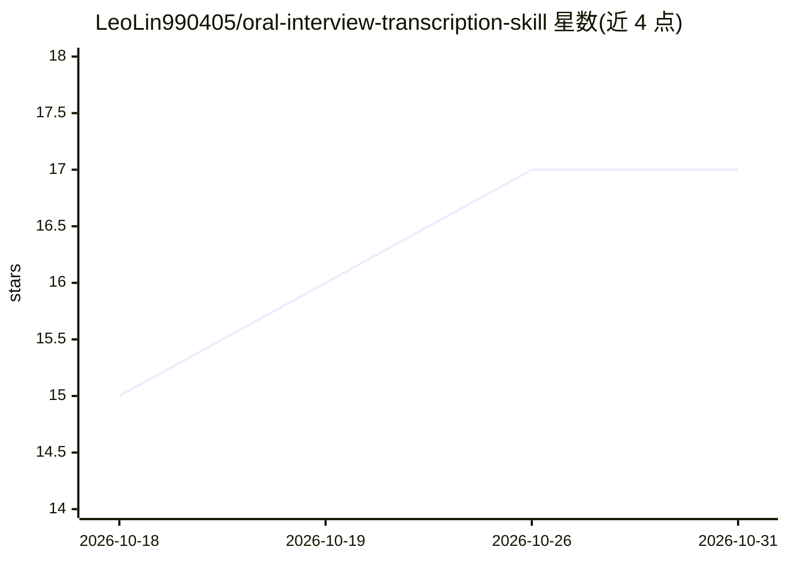

# LeoLin990405/oral-interview-transcription-skill

⭐ 17 · Python · MIT · 推送 2026-10-22 · [GitHub](https://github.com/LeoLin990405/oral-interview-transcription-skill) · 个人维护 · 中文 README

**口述史逐字稿去口语化的 Claude Skill 流水线，存真优先**

面向口述史研究者、播客与质性研究整理者的转录稿处理工具：输入为已转写的逐字稿（不做 ASR），通过多角色串行流水线将口语稿整理为忠实可读的整理稿（Pass 1），并可在受访人审阅签字后进一步生成书面稿（Pass 2）。机制包括机读执行契约 term_lock、分块与全局术语锚定、consistency/fidelity 双重质量门及对抗式忠实度审计技能；输出逐段字级审阅包。以 Claude/Agent Skill 形式提供，亦可手动运行 Python 脚本；核心流水线仅依赖 Python 3.9+ 标准库，数据本地处理不外传。README 声明工具处于早期阶段，不替代人工审定。

## 筛选速览

| 维度 | 判定 | 备注 |
|---|---|---|
| AI 角色 | `ai-native` | 本体是模型或模型工具 |
| 许可风险 | `permissive` | MIT |
| 部署形态 | `None` |  |
| 模型依赖 | — | README 未给出锁定关系 |
| 硬件要求 | — | 无带数字的原话,不猜 |
| 安装摩擦 | `low` | 无编译、无系统依赖或容器化 |
| 成熟度 | `idea` | |

## 能力要点

- term_lock 机读执行契约 + 分块术语锚定抵抗长文漂移
- consistency_checker 与 fidelity_checker 双重质量门
- 对抗式忠实度审计技能逐句核查捏造与方言抹除
- 逐段字级 diff 审阅包（Markdown/HTML/Word）替代模型自报改动

## 适用场景

- 口述史访谈逐字稿整理为忠实整理稿
- 播客与通用访谈转写稿去口语化、书面化
- 长访谈稿跨块术语与人名一致性校验
- 整理稿交付前做忠实度审计与人工复核

## 场景标签

`AI 写作` · 领域:内容生成

## 证据(README 行号)

> L9: 口述史研究中，访谈逐字稿的整理是最耗时、且最易引入失真的环节。同一套去口语化问题也出现在播客与通用访谈的逐字稿上。本工具面向**已完成语音转写的逐字稿**（非录音转写本身），提供一条以方法论为约束、以"存真"为最高原则的处理流水线：
> L86: - **作为 Claude / Agent Skill**：将 `oral-history-master/` 与 `oral-history-quality-guard/` 置入 skills 目录，由 Agent 编排执行（推荐

## 星数曲线

2026-10-18 15 → 2026-10-31 17（+2）

---
*卡片 v1 · prompt 1.4 · 生成 2026-10-30 · 置信度 high · 依据 README sha `5767f0e8ade2` · [字段定义](../../DATASET.md)*
