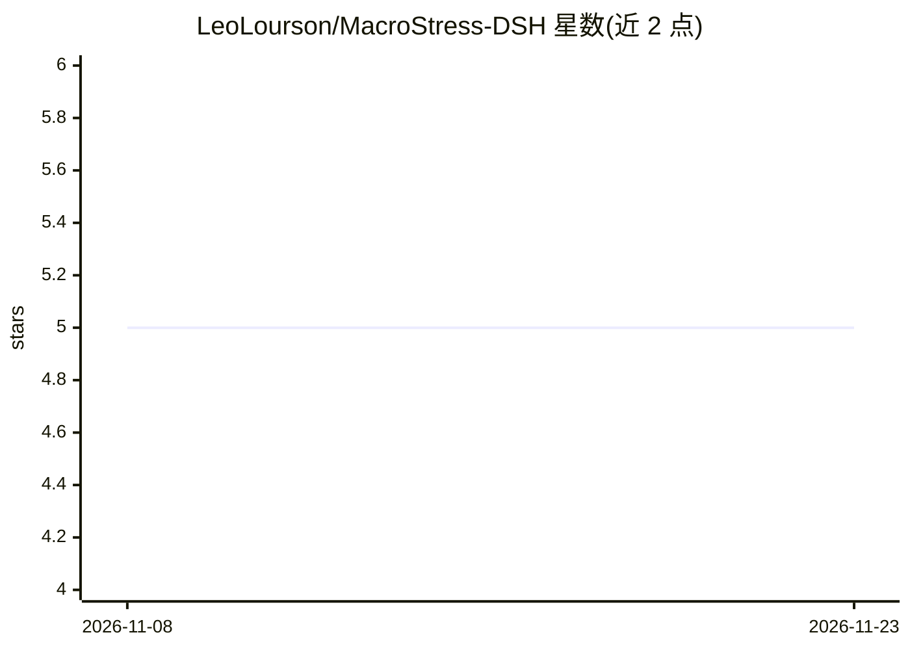

# LeoLourson/MacroStress-DSH

⭐ 5 · Python · MIT · 推送 2026-11-17 · [GitHub](https://github.com/LeoLourson/MacroStress-DSH) · 个人维护 · 中文 README

**给投资组合做宏观压力测试的 MCP 服务器与 Python 平台**

用户用自然语言陈述一个事件，LLM agent 基于语料库将其写成形式化情景（含干预与观测、数字来源标注），经人工批准后由分层计量模型（宏观 BVAR/MS-VAR、卫星模型、资产定价插件）在情景路径上重估持仓，输出逐月损失分位数与 ES95 及情景价格（KL 散度）。模型与资产类型均为插件，平台通过 MCP 七个工具驱动，无 Web 界面与数据库，状态存于单一工作区目录。需 Python 3.12+ 与 uv。

## 筛选速览

| 维度 | 判定 | 备注 |
|---|---|---|
| AI 角色 | `ai-native` | 本体是模型或模型工具 |
| 许可风险 | `permissive` | MIT |
| 部署形态 | `None` |  |
| 模型依赖 | — | README 未给出锁定关系 |
| 硬件要求 | — | 无带数字的原话,不猜 |
| 安装摩擦 | `low` | 无编译、无系统依赖或容器化 |
| 成熟度 | — | 结构信号不足 |

## 能力要点

- 自然语言事件→经人工批准的形式化情景，每个数字标注来源
- 分层建模：宏观/卫星/资产定价模型均为插件，新增无需改核心
- MCP 服务器，提供 7 个工具，支持任意 MCP 客户端
- 输出逐月损失分位数、ES95、情景价格与反向搜索

## 适用场景

- 评估某宏观事件（加息、出口禁令）对组合的逐月损失分布
- 用历史事件回测检验情景模型的相对表现
- 为自有行业或资产类型编写插件接入压力测试框架

## 场景标签

`RAG` `金融量化` · 领域:知识与检索

## 证据(README 行号)

> L11: for a year", or "fertiliser exports are banned". An LLM agent turns the event into a scenario, a
> L124: The server speaks MCP, so any MCP client can drive it: Claude Desktop, Claude Code, Cursor,
> L126: `model`; long operations run as jobs. The `dsh/` folder holds a plugin for DeepSeek Harness (DSH)

## 星数曲线

2026-11-08 5 → 2026-11-23 5（+0）

---
*卡片 v1 · prompt 1.4 · 生成 2026-11-21 · 置信度 high · 依据 README sha `1ecb8904fcca` · [字段定义](../../DATASET.md)*
