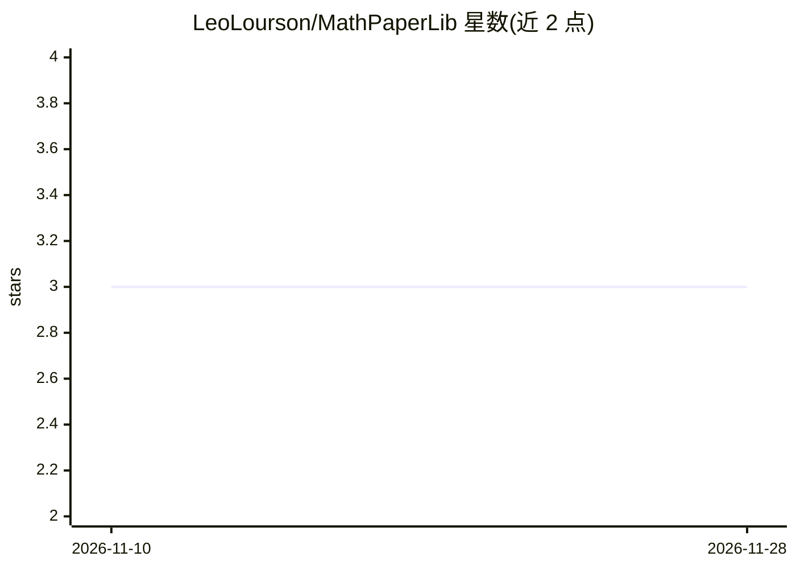

# LeoLourson/MathPaperLib

⭐ 3 · Python · MIT · 推送 2026-11-09 · [GitHub](https://github.com/LeoLourson/MathPaperLib) · 个人维护

**为 AI agent 提供数学文献检索、下载与全文搜索的 MCP 服务器**

把用户所有论文统一存放在 ~/Literature 库中，按「作者 年份 - 标题」规则命名，每个项目只保留引用注册表。提供文献查找（zbMATH/arXiv/Math-Net/CrossRef/OpenAlex/S2）、DOI 解析、引文查询、下载入库、收件箱 PDF 自动识别归档、全文搜索（BM25 结合 multilingual-e5-small 嵌入，CPU 运行）以及 PDF 逐页读取与转写为 LaTeX。以 MCP 服务器（stdio）和 `lit` 命令行两种形式提供，仅下载开放获取副本，工具消息为俄语。

## 筛选速览

| 维度 | 判定 | 备注 |
|---|---|---|
| AI 角色 | `ai-enhanced` | 去掉 AI 部分产品仍成立 |
| 许可风险 | `permissive` | MIT |
| 部署形态 | `None` |  |
| 模型依赖 | — | README 未给出锁定关系 |
| 硬件要求 | — | 无带数字的原话,不猜 |
| 安装摩擦 | `low` | 无编译、无系统依赖或容器化 |
| 成熟度 | — | 结构信号不足 |

## 能力要点

- MCP 服务器形式，任何支持 MCP 的 agent harness 均可启动
- 收件箱 PDF 通过 arXiv 号/DOI 自动识别并按统一规则归档
- 全文搜索结合 BM25 与 intfloat/multilingual-e5-small 嵌入模型，CPU 运行
- 提供 Claude Code 插件、DSH bundle 与 Codex 配置三种接入方式

## 适用场景

- 让 AI agent 检索、下载并逐页阅读数学论文
- 多项目共用一个文献库，避免重复下载与索引
- 对项目引用的论文生成目录并核对其描述
- 把 PDF 论文分部分转写为 LaTeX 并用 pdflatex 校验

## 场景标签

`科研工具` `文档解析` · 领域:知识与检索

## 证据(README 行号)

> L7: and gives an AI agent tools to find papers, download them, read them page by page and search
> L8: their full texts. The tools run as an MCP server, which any agent harness with MCP support can
> L46: Put a PDF you downloaded into `inbox/` and run `lit inbox`, or let the agent call the `inbox`

## 星数曲线

2026-11-10 3 → 2026-11-28 3（+0）

---
*卡片 v1 · prompt 1.4 · 生成 2026-11-22 · 置信度 high · 依据 README sha `745375341a44` · [字段定义](../../DATASET.md)*
