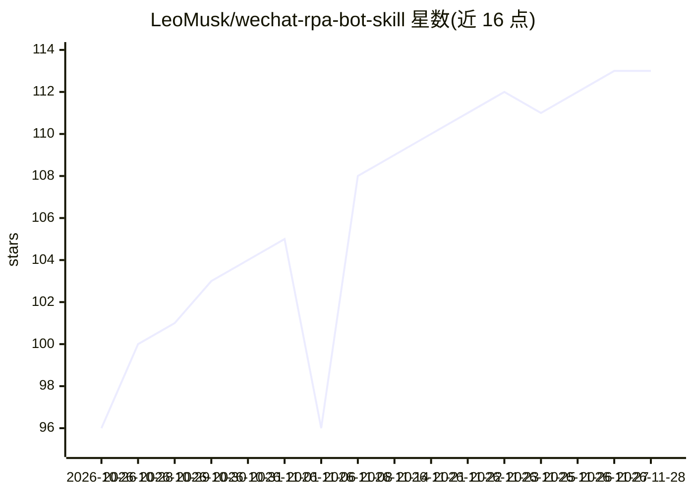

# LeoMusk/wechat-rpa-bot-skill

⭐ 113 · 推送 2026-11-25 · [GitHub](https://github.com/LeoMusk/wechat-rpa-bot-skill) · [官网](https://yobot.yokoagi.com) · 组织维护 · 中文 README

**给 AI 智能体安装的微信 RPA 技能：本地 MCP 服务驱动微信操作**

将本机微信桌面端封装为纯本地服务（127.0.0.1:9922），通过 MCP 协议（约 28 个工具）与 REST API 暴露发消息、发朋友圈、真实语音气泡、按标签群发、读联系人、群聊总结等能力。技术路线为纯 RPA/系统原生 UI 自动化，不读微信数据库、不改内存、不碰私有协议。安装器将服务驻留在用户桌面会话，Agent 仅作网络客户端接入，规避沙箱会话隔离。提供 YoBot 客户端集中管理方式与独立 MCP 安装包两种路径，激活采用激活码绑定。

## 筛选速览

| 维度 | 判定 | 备注 |
|---|---|---|
| AI 角色 | `ai-ecosystem` | LLM/agent 周边工具 |
| 许可风险 | `permissive` | — |
| 部署形态 | `desktop` | 安装包/桌面程序 |
| 模型依赖 | — | README 未给出锁定关系 |
| 硬件要求 | — | 无带数字的原话,不猜 |
| 安装摩擦 | `low` | 无编译、无系统依赖或容器化 |
| 成熟度 | — | 结构信号不足 |

## 能力要点

- 以 MCP 工具形式暴露约 28 项微信操作能力，宿主 Agent 连接后原生可调用
- 纯 RPA/UI 自动化路线：模拟真人鼠标键盘，不读数据库、不改内存
- 服务由安装器注册开机自启并崩溃自愈，Agent 只作网络客户端
- 支持发送真实微信语音气泡（需微信 ≥ 4.1.9 与 VB-Cable 虚拟音频驱动）

## 适用场景

- 让 OpenClaw/QClaw 等 Agent 通过自然语言代发微信消息和朋友圈
- 给指定标签客户批量创建定时群发任务
- 让 Agent 总结客户群聊天记录并跟进待办
- 企业自建智能体通过 API 接入处理微信咨询

## 场景标签

`GUI 自动化` · 领域:效率与自动化

## 证据(README 行号)

> L5: **WeChat RPA Bot Skill（微信 RPA 机器人技能 / `wechat-rpa-bot-skill`）是一个面向 AI 智能体、纯本地运行的微信 RPA（机器人流程自动化）技能。** 它把你电脑上的一个微信桌面端
> L7: 它区别于传统微信机器人库：**不是给开发者写代码用的 SDK，而是一个能被 AI 智能体一键安装、渐进式读文档自主调用的"技能"**。技术路线是纯 RPA / 系统原生 UI 自动化（完全模拟真人鼠标键盘），因此合规、透明、可控，适
> L42: **本技能的微信能力，由一个纯本地运行的 MCP 服务 `yoko_rpa_mcp.exe` 对外提供。** 它在你的电脑上常驻（端口 `9922`），把「发消息 / 群发 / 发朋友圈 / 发真实语音气泡 / 读联系人 / 群聊

## 星数曲线

2026-10-26 96 → 2026-11-28 113（+17）

---
*卡片 v1 · prompt 1.4 · 生成 2026-11-28 · 置信度 high · 依据 README sha `7f2b5dc410c5` · [字段定义](../../DATASET.md)*
