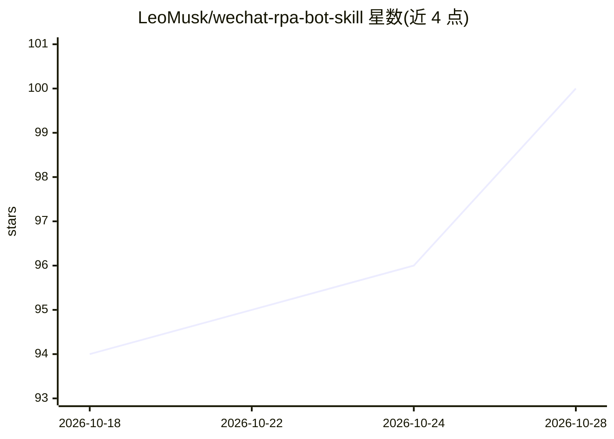

# LeoMusk/wechat-rpa-bot-skill

⭐ 101 · 推送 2026-10-27 · [GitHub](https://github.com/LeoMusk/wechat-rpa-bot-skill) · [官网](https://yobot.yokoagi.com) · 个人维护 · 中文 README

**给 AI 智能体用的微信 RPA 技能：本地 MCP 服务暴露微信操作**

面向 AI 智能体（OpenClaw/QClaw/WorkBuddy 等）的微信自动化技能：将本机微信桌面端封装为纯本地服务（127.0.0.1:9922），以约 27 个 MCP 工具及 REST API 暴露发消息、群发、朋友圈、真实语音气泡、通讯录读取等能力。技术路线为 RPA/UI 自动化（模拟鼠标键盘），不读数据库、不改内存。需官方安装器安装 yoko_rpa_mcp.exe 并用激活码激活；要求微信桌面版 ≥4.1.7（语音需 ≥4.1.9），语音发送另需 VB-Cable 虚拟音频驱动。数据全部本地处理。也可改由 YoBot 托管接入。

## 筛选速览

| 维度 | 判定 | 备注 |
|---|---|---|
| AI 角色 | `ai-ecosystem` | LLM/agent 周边工具 |
| 许可风险 | `permissive` | — |
| 部署形态 | `desktop` | 安装包/桌面程序 |
| 模型依赖 | — | README 未给出锁定关系 |
| 硬件要求 | — | 无带数字的原话,不猜 |
| 安装摩擦 | `low` | 无编译、无系统依赖或容器化 |
| 成熟度 | — | 结构信号不足 |

## 能力要点

- 约 27 个 MCP 工具 + REST API 暴露微信能力，服务本地常驻（崩溃自愈、开机自启）
- 纯 RPA/UI 自动化路线：不读微信数据库、不改内存、不碰私有协议
- 支持真实微信语音气泡（v1.7.9+，克隆音色实时合成）
- 提供本地 Web 可视化控制台（Human-in-the-Loop）

## 适用场景

- 让 OpenClaw/QClaw 等 Agent 用自然语言操作我的微信发消息、群发、发朋友圈
- 个人或小团队在本地自动化微信私域运营
- 按好友标签批量群发问候与通知
- 让 Agent 总结群聊记录、读取通讯录

## 场景标签

`GUI 自动化` · 领域:效率与自动化

## 证据(README 行号)

> L5: **WeChat RPA Bot Skill（微信 RPA 机器人技能 / `wechat-rpa-bot-skill`）是一个面向 AI 智能体、纯本地运行的微信 RPA（机器人流程自动化）技能。** 它把你电脑上的一个微信桌面端
> L38: **本技能的微信能力，由一个纯本地运行的 MCP 服务 `yoko_rpa_mcp.exe` 对外提供。** 它在你的电脑上常驻（端口 `9922`），把「发消息 / 群发 / 发朋友圈 / 发真实语音气泡 / 读联系人 / 群聊

## 星数曲线

2026-10-18 94 → 2026-10-28 100（+6）

---
*卡片 v1 · prompt 1.4 · 生成 2026-10-23 · 置信度 high · 依据 README sha `45ef18c5ef81` · [字段定义](../../DATASET.md)*
