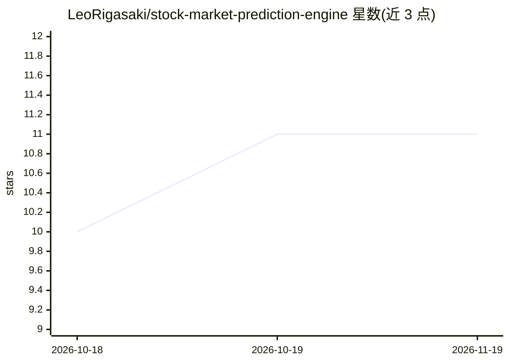

# LeoRigasaki/stock-market-prediction-engine

⭐ 11 · Python · 推送 2026-03-11 · [GitHub](https://github.com/LeoRigasaki/stock-market-prediction-engine) · 个人维护

**面向量化研究者的股票预测 ML 系统（API+仪表盘）**

基于 FastAPI 与 Streamlit 的研究型股票预测与组合分析系统：通过 yfinance 获取实时行情，使用 XGBoost、LightGBM、随机森林及简单平均/投票/堆叠集成模型进行 5 日收益预测，基于 73 个工程化特征；提供鉴权 API 端点、实时推理、walk-forward 验证工件、成本调整后的风险指标与组合优化。README 明确声明这是研究系统而非可部署的交易策略，并指出样本外回归拟合较弱。

## 筛选速览

| 维度 | 判定 | 备注 |
|---|---|---|
| AI 角色 | `ai-native` | 本体是模型或模型工具 |
| 许可风险 | `none` | — |
| 部署形态 | `self-host` | docker 或自建部署 |
| 模型依赖 | — | README 未给出锁定关系 |
| 硬件要求 | — | 无带数字的原话,不猜 |
| 安装摩擦 | `low` | 无编译、无系统依赖或容器化 |
| 成熟度 | — | 结构信号不足 |

## 能力要点

- 集成 XGBoost/LightGBM/随机森林与多种集成模型，73 个工程化特征
- 基于保存的评估摘要进行分数加权集成推理，而非固定单一模型
- 提供鉴权 FastAPI 端点与 Streamlit 仪表盘
- 附带 walk-forward 验证与基准对比工件（等权/动量/均值回归）

## 适用场景

- 跑通一个端到端的量化预测研究流水线
- 查看实时预测与模型排名结果
- 学习成本调整后风险指标与 walk-forward 验证的实践方法

## 场景标签

`金融量化` · 领域:学习与行业

## 证据(README 行号)

> L3: Research-oriented stock prediction and portfolio analytics system built with FastAPI, Streamlit, and classical/ensem
> L6: - live inference from current market data
> L79: - individual models: XGBoost, LightGBM, Random Forest

## 星数曲线

2026-10-18 10 → 2026-11-19 11（+1）

---
*卡片 v1 · prompt 1.4 · 生成 2026-11-19 · 置信度 high · 依据 README sha `40589f352e0c` · [字段定义](../../DATASET.md)*
