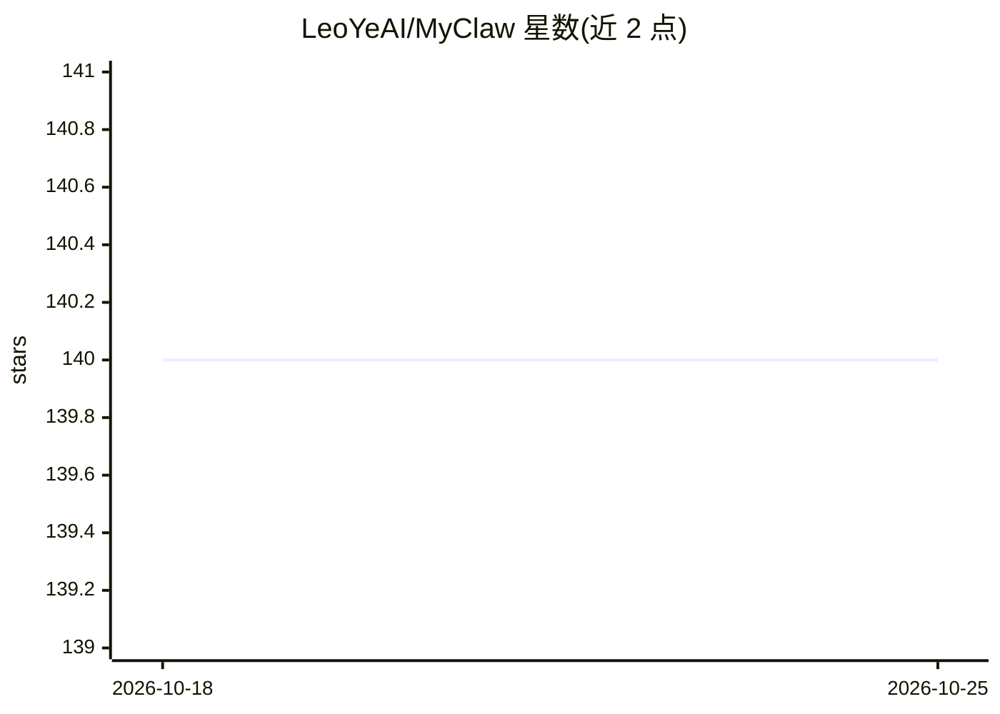

# LeoYeAI/MyClaw

⭐ 140 · 推送 2026-04-02 · [GitHub](https://github.com/LeoYeAI/MyClaw) · [官网](https://myclaw.ai) · 组织维护 · 中文 README

**托管个人 AI 服务器服务：按月付费运行 OpenClaw 平台**

MyClaw.ai 是一项付费托管服务：注册账号后获得一个完整运行的 OpenClaw（开源 AI agent 平台）服务器实例，用户可部署技能、构建自动化任务、接入任意 API。功能包括多实例创建、持久记忆、经 ClawHub 市场获取的 100+ 预置技能。提供 Lite/Pro/Max 三档订阅（$19–$79/月）。该团队同时维护 openclaw-guardian、myclaw-backup、myclaw-bench 等生态项目。获取方式为官网注册，不涉及本地安装。

## 筛选速览

| 维度 | 判定 | 备注 |
|---|---|---|
| AI 角色 | `ai-ecosystem` | LLM/agent 周边工具 |
| 许可风险 | `none` | — |
| 部署形态 | `None` |  |
| 模型依赖 | — | README 未给出锁定关系 |
| 硬件要求 | — | 无带数字的原话,不猜 |
| 安装摩擦 | `low` | 无编译、无系统依赖或容器化 |
| 成熟度 | — | 结构信号不足 |

## 能力要点

- 每个实例是一个完整的 OpenClaw 服务器部署
- 经 ClawHub 市场提供 100+ 预置技能
- 支持多实例、持久记忆与自定义 API 集成
- 团队维护 openclaw-guardian、myclaw-bench 等开源生态项目

## 适用场景

- 我想要一个不用自己运维的个人 AI agent 服务器
- 为不同项目分别部署自动化 agent 实例
- 通过技能市场扩展 agent 的任务能力

## 场景标签

`Agent 框架` `工作流自动化` · 领域:Agent 开发

## 证据(README 行号)

> L15: MyClaw.ai gives every user a complete server running OpenClaw — the open-source AI agent platform. Each instance is
> L19: - 🤖 **AI Agent Platform** — Build, deploy, and manage intelligent agents

## 星数曲线

2026-10-18 140 → 2026-10-25 140（+0）

---
*卡片 v1 · prompt 1.4 · 生成 2026-10-22 · 置信度 mid · 依据 README sha `3369ee6db970` · [字段定义](../../DATASET.md)*
