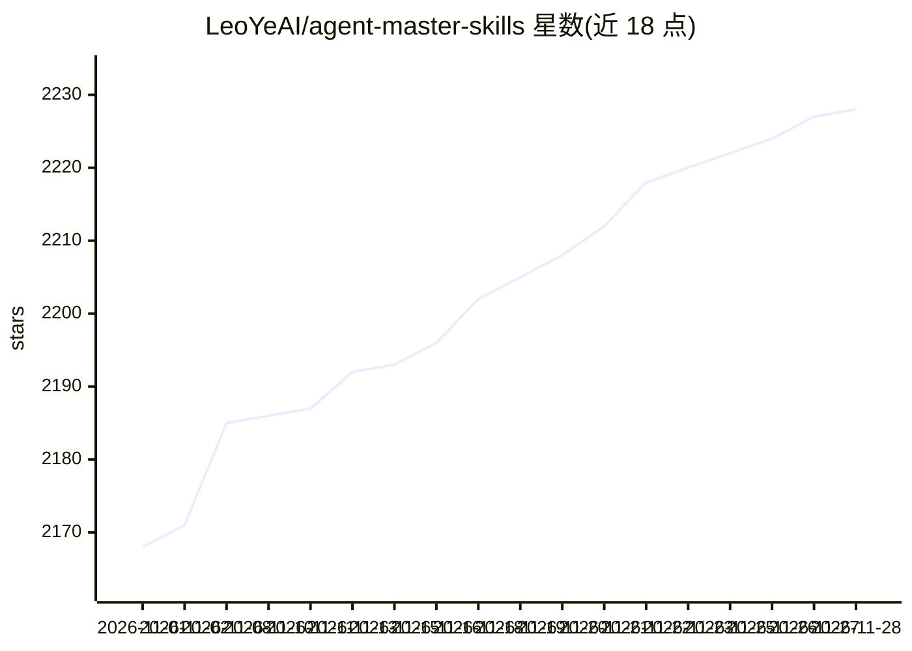

# LeoYeAI/agent-master-skills

⭐ 2,228 · Python · MIT · 推送 2026-11-22 · [GitHub](https://github.com/LeoYeAI/agent-master-skills) · [官网](https://myclaw.ai) · 组织维护 · 中文 README

**面向 agent 运行时的技能策展合集（3200+，每日更新）**

由 MyClaw.ai 维护的 Agent Skills 合集，收录覆盖 AI、搜索、办公等领域的 SKILL.md 格式技能，README 标注每日更新。主打 harness-agnostic：每个技能为符合 Agent Skills 规范的文件夹，可被 Claude Code、Codex、Cursor、Gemini CLI、OpenClaw 等任何读取该格式的运行时消费；给出各运行时的项目级与全局技能目录对照表。整体安装用 clawhub 命令，单个技能通过 git clone 后复制；README 提供分类技能索引（如 AI & LLM Tools 50 条、Search & Web 21 条）。

## 筛选速览

| 维度 | 判定 | 备注 |
|---|---|---|
| AI 角色 | `ai-knowledge` | 知识聚合/清单类 |
| 许可风险 | `permissive` | MIT |
| 部署形态 | `None` |  |
| 模型依赖 | — | README 未给出锁定关系 |
| 硬件要求 | — | 无带数字的原话,不猜 |
| 安装摩擦 | `medium` | 含编译或系统依赖之一 |
| 成熟度 | — | 结构信号不足 |

## 能力要点

- SKILL.md 标准格式，兼容任意读取该格式的 agent 运行时
- 提供 13 个 harness 的技能目录对照表
- 分类技能索引（AI/搜索/办公等类别）
- clawhub 一键安装或 git clone 复制单个技能

## 适用场景

- 为我的 Claude Code / Cursor 等运行时批量补充技能
- 按类别查找现成的搜索、文档处理类 agent 技能
- 了解 agent skills 生态中有哪些可用技能

## 场景标签

`精选清单` · 领域:学习与行业

## 证据(README 行号)

> L14: **MyClaw.ai** is an AI personal assistant platform that gives every user a fully-featured AI agent running on a ded
> L20: This is a **harness-agnostic** collection: every skill is a plain `SKILL.md`
> L64: ## 📦 Skill Index (388 curated skills)

## 星数曲线

2026-11-01 2,168 → 2026-11-28 2,228（+60）

---
*卡片 v1 · prompt 1.4 · 生成 2026-11-23 · 置信度 high · 依据 README sha `0deee733cd76` · [字段定义](../../DATASET.md)*
