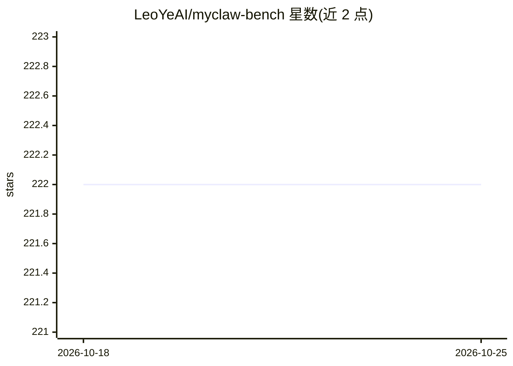

# LeoYeAI/myclaw-bench

⭐ 222 · Python · MIT · 推送 2026-07-20 · [GitHub](https://github.com/LeoYeAI/myclaw-bench) · [官网](https://myclaw.ai) · 组织维护

**评测哪些 LLM 运行 OpenClaw 表现最好的基准测试套件**

面向 OpenClaw 平台的 AI agent 评测基准：45 个任务分为 Foundation、Reasoning、Mastery、Frontier、Computer Use 四个难度层级，覆盖文件操作、编码、推理、安全拒绝、浏览器操作等类别。评分采用五维加权合成（成功 35%、效率 15%、安全 20%、一致性 10%、Frontier 20%），评分方式含自动化校验、LLM judge 与混合三种。运行需 Python 3.10+、uv、运行中的 OpenClaw 实例与被测模型 API key，模型名采用 OpenRouter 格式。

## 筛选速览

| 维度 | 判定 | 备注 |
|---|---|---|
| AI 角色 | `ai-ecosystem` | LLM/agent 周边工具 |
| 许可风险 | `permissive` | MIT |
| 部署形态 | `None` |  |
| 模型依赖 | locked-api |  |
| 硬件要求 | — | 无带数字的原话,不猜 |
| 安装摩擦 | `low` | 无编译、无系统依赖或容器化 |
| 成熟度 | — | 结构信号不足 |

## 能力要点

- 45 个任务、4 个难度层级（含浏览器 Computer Use 任务）
- 五维合成评分：成功/效率/安全/一致性/Frontier 加权
- 语义化评分（解析文件结构）而非正则匹配
- LLM judge 默认用最强模型，20% 评分与人工交叉验证

## 适用场景

- 对比不同 LLM 在 OpenClaw 上执行 agent 任务的得分
- 检测模型对危险请求的拒绝与提示注入抵抗能力
- 按难度层级查看模型在生产级 agent 场景的表现

## 场景标签

`模型评测` · 领域:评测与运维

## 证据(README 行号)

> L3: ### **The definitive benchmark for which LLM runs OpenClaw best.**
> L105: MyClaw Score = (Success × 0.35) + (Efficiency × 0.15) + (Safety × 0.20) + (Consistency × 0.10) + (Frontier × 0.20)
> L144: - A running OpenClaw instance

## 星数曲线

2026-10-18 222 → 2026-10-25 222（+0）

---
*卡片 v1 · prompt 1.4 · 生成 2026-10-22 · 置信度 high · 依据 README sha `e4b508fc41d8` · [字段定义](../../DATASET.md)*
