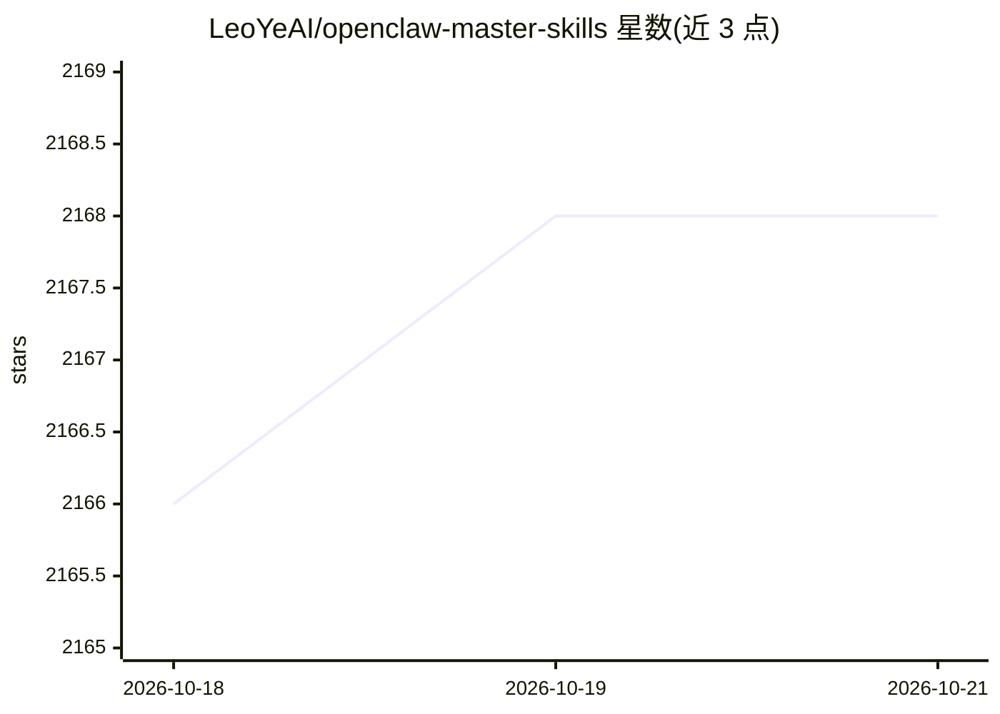

# LeoYeAI/openclaw-master-skills

⭐ 2,168 · Python · MIT · 推送 2026-07-20 · [GitHub](https://github.com/LeoYeAI/openclaw-master-skills) · [官网](https://myclaw.ai) · 组织维护 · 中文 README

**MyClaw.ai 维护的 OpenClaw agent 技能策展清单（1211+，周更）**

由 MyClaw.ai 团队维护的 agent 技能聚合仓库：从生态中挑选 1211+ 个 OpenClaw 技能，每周更新，按 AI/LLM 工具、搜索与网页、生产力与办公等类别组织索引，每条给出技能名与功能描述。条目涵盖浏览器自动化、网页搜索、文档处理、图像生成、语音转写等任务。安装方式为通过 ClawHub 安装单个技能，或 git clone 后手动复制到 ~/.openclaw/workspace/skills/。README 另推广 MyClaw.ai 的 AI 助手托管平台。

## 筛选速览

| 维度 | 判定 | 备注 |
|---|---|---|
| AI 角色 | `ai-knowledge` | 知识聚合/清单类 |
| 许可风险 | `permissive` | MIT |
| 部署形态 | `None` |  |
| 模型依赖 | — | README 未给出锁定关系 |
| 硬件要求 | — | 无带数字的原话,不猜 |
| 安装摩擦 | `medium` | 含编译或系统依赖之一 |
| 成熟度 | — | 结构信号不足 |

## 能力要点

- 1211+ 个技能，每周更新
- 按类别组织索引，条目附功能描述
- 支持 clawhub install 或 git clone 手动安装

## 适用场景

- 为 OpenClaw agent 查找和安装所需技能
- 浏览 agent 技能生态的覆盖范围
- 按 AI 工具、搜索、办公等类别筛选技能

## 场景标签

`精选清单` · 领域:学习与行业

## 证据(README 行号)

> L6: 1211+ Skills
> L14: **MyClaw.ai** is an AI personal assistant platform that gives every user a fully-featured AI agent running on a ded

## 星数曲线

2026-10-18 2,166 → 2026-10-21 2,168（+2）

---
*卡片 v1 · prompt 1.4 · 生成 2026-10-21 · 置信度 high · 依据 README sha `501588223271` · [字段定义](../../DATASET.md)*
