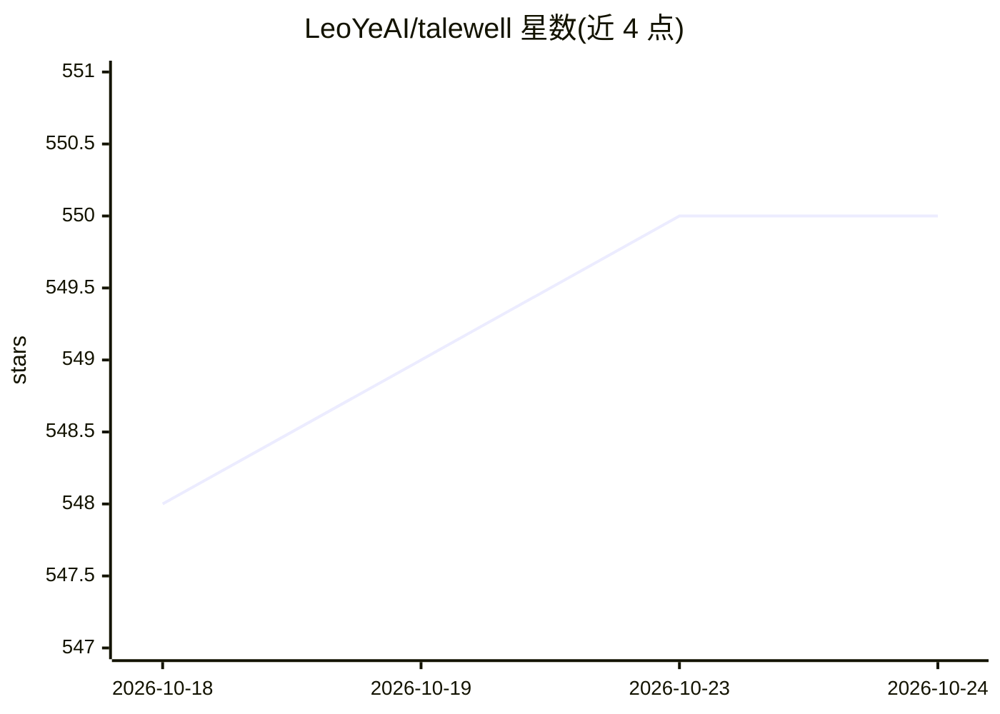

# LeoYeAI/talewell

⭐ 550 · JavaScript · MIT · 推送 2026-10-01 · [GitHub](https://github.com/LeoYeAI/talewell) · [官网](https://myclaw.ai) · 组织维护 · 中文 README

**面向各类 agent 平台的插件式长期记忆层，AMP 协议参考实现**

以 git 上的纯 Markdown 文件作为记忆存储（一条记录一个文件，每次写入即提交），提供本地确定性召回（相关性×新近度×重要性，无需模型调用与 API key）、来源污染门控（owner/agent 可存，untrusted 拒绝）、记录取代与 [[id]] 链接图。通过 MCP 服务器、OpenClaw 插件、AGENTS.md/CLAUDE.md 文件约定三种方式接入，覆盖 9 个宿主平台，并附 CLI 与 28 个测试。它是 AMP（Agent Memory Protocol）的参考实现，v0.1 版本，前身为 OpenClaw Auto-Dream 技能。

## 筛选速览

| 维度 | 判定 | 备注 |
|---|---|---|
| AI 角色 | `ai-ecosystem` | LLM/agent 周边工具 |
| 许可风险 | `permissive` | MIT |
| 部署形态 | `None` |  |
| 模型依赖 | — | README 未给出锁定关系 |
| 硬件要求 | — | 无带数字的原话,不猜 |
| 安装摩擦 | `low` | 无编译、无系统依赖或容器化 |
| 成熟度 | `idea` | |

## 能力要点

- 一条记忆一个 Markdown 文件，git 历史可 diff/回滚
- 本地确定性召回，基线运行无需向量库、网络与 API key
- 来源污染结构性门控与取代式纠错
- MCP/OpenClaw 插件/文件约定三种接入方式，支持 9 个宿主

## 适用场景

- 为 Claude Code、Codex、OpenClaw 等 agent 宿主加长期记忆
- 对记忆内容做可审计的 git 版本管理与回滚
- 通过 MCP 让任意支持 MCP 的客户端获得记忆工具集

## 场景标签

`Agent 记忆` · 领域:Agent 开发

## 证据(README 行号)

> L9:  Plugin-first long-term memory for every agent platform.
> L41: ### As an MCP server — works with anything that speaks MCP
> L83: |OpenClaw|native, mcp, file, cli|`AGENTS.md`|yes|

## 星数曲线

2026-10-18 548 → 2026-10-24 550（+2）

---
*卡片 v1 · prompt 1.4 · 生成 2026-10-21 · 置信度 high · 依据 README sha `8194711d395b` · [字段定义](../../DATASET.md)*
