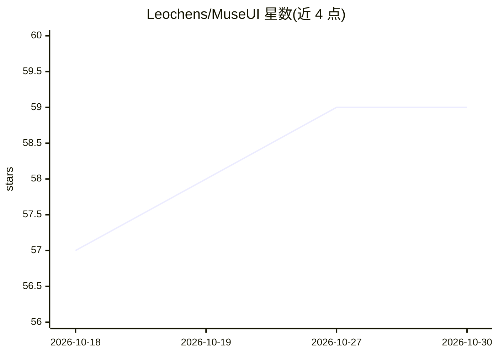

# Leochens/MuseUI

⭐ 59 · TypeScript · MIT · 推送 2026-06-25 · [GitHub](https://github.com/Leochens/MuseUI) · [官网](https://muse.guantou.site/) · 组织维护 · 中文 README

**浏览器端 AI 图像生成器：用提示词生成 UI 稿与视觉设计**

纯前端 Vite + React 单页应用，无后端、无鉴权、无服务端数据库。用户在浏览器设置中填入自己的 AI API Key（存于 localStorage），调用 Gemini 与 OpenAI 兼容端点，从提示词与参考图生成 UI 模拟稿、社交图、封面、信息图、贴纸、Logo 等视觉草稿；提供画布工作区与多种技能模式，项目和历史存于本地 IndexedDB。限制：不提供托管 API、不代理后端、不向服务器上传数据。界面为中英双语。

## 筛选速览

| 维度 | 判定 | 备注 |
|---|---|---|
| AI 角色 | `ai-native` | 本体是模型或模型工具 |
| 许可风险 | `permissive` | MIT |
| 部署形态 | `library` | 以包/库形式分发 |
| 模型依赖 | — | README 未给出锁定关系 |
| 硬件要求 | — | 无带数字的原话,不猜 |
| 安装摩擦 | `low` | 无编译、无系统依赖或容器化 |
| 成熟度 | — | 结构信号不足 |

## 能力要点

- 纯浏览器静态应用，无后端，API Key 仅存本地 localStorage
- 支持 Gemini 与 OpenAI 兼容端点的多提供商配置
- 画布工作区与封面/信息图/漫画/幻灯片/Logo/贴纸等技能模式
- 本地 IndexedDB 存储项目与生成历史，中英双语界面

## 适用场景

- 用提示词快速生成 UI 模拟稿与设计草稿
- 制作社交配图、封面、信息图、贴纸、Logo 等视觉内容
- 在不上传数据到服务器的前提下使用自有 AI API Key 做图像生成

## 场景标签

`图像生成` · 领域:内容生成

## 证据(README 行号)

> L7: MuseUI is a browser-only AI interface and image design generator. It helps you create UI mockups, social images, cov
> L9: The app is a static Vite + React SPA. It has no backend, no authentication, and no server database. Users provide th

## 星数曲线

2026-10-18 57 → 2026-10-30 59（+2）

---
*卡片 v1 · prompt 1.4 · 生成 2026-10-24 · 置信度 high · 依据 README sha `cceed6b95357` · [字段定义](../../DATASET.md)*
