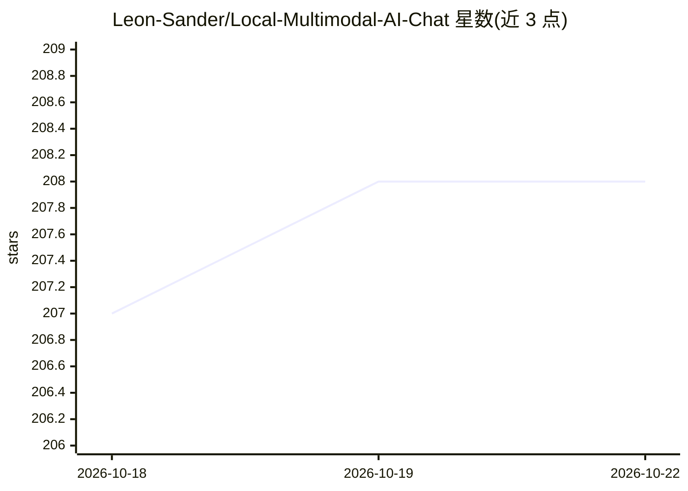

# Leon-Sander/Local-Multimodal-AI-Chat

⭐ 208 · Python · GPL-3.0 · 推送 2026-07-10 · [GitHub](https://github.com/Leon-Sander/Local-Multimodal-AI-Chat) · 个人维护

**自托管本地多模态聊天应用：文字/图像/PDF/语音对话**

基于 Streamlit 的可自托管聊天应用，通过 Ollama 在本地运行开源模型（可选 OpenAI API 回退），在单一界面中支持文本对话、图像对话（如 LLaVA 视觉模型）、基于 Chroma 向量库的 PDF RAG 问答，以及 Whisper 语音转文字输入。会话与设置持久化于 SQLite。以 Docker Compose 为主推安装方式，也提供手动安装路径（Python 3.10 虚拟环境 + pip），音频处理依赖 ffmpeg。

## 筛选速览

| 维度 | 判定 | 备注 |
|---|---|---|
| AI 角色 | `ai-native` | 本体是模型或模型工具 |
| 许可风险 | `viral` | GPL-3.0 |
| 部署形态 | `self-host` | docker 或自建部署 |
| 模型依赖 | local-ok | 支持本地模型 |
| 硬件要求 | — | 无带数字的原话,不猜 |
| 安装摩擦 | `low` | 无编译、无系统依赖或容器化 |
| 成熟度 | — | 结构信号不足 |

## 能力要点

- Ollama 本地推理，可在运行时切换 OpenAI API
- PDF RAG：Chroma 向量库 + Ollama nomic-embed-text 嵌入
- Whisper 语音输入与图像多模态对话
- SQLite 持久化多会话历史，Docker Compose 一键部署

## 适用场景

- 在自己机器上与本地模型进行文本/图像/语音多模态对话
- 对自有 PDF 文档做检索增强问答
- 无云端依赖地保留聊天历史与数据

## 场景标签

`聊天机器人` `多模态` `文档问答` `语音识别` · 领域:对话与助手

## 证据(README 行号)

> L3: A self-hostable, multimodal chat application that runs open-source models locally. Chat with **text, images, PDFs, a
> L15: Local Multimodal AI Chat integrates several AI models behind a single Streamlit interface, with a focus on **data p
> L20: - **Speak instead of type**: audio is transcribed with Whisper.

## 星数曲线

2026-10-18 207 → 2026-10-22 208（+1）

---
*卡片 v1 · prompt 1.4 · 生成 2026-10-22 · 置信度 high · 依据 README sha `7ae4c4ea1340` · [字段定义](../../DATASET.md)*
