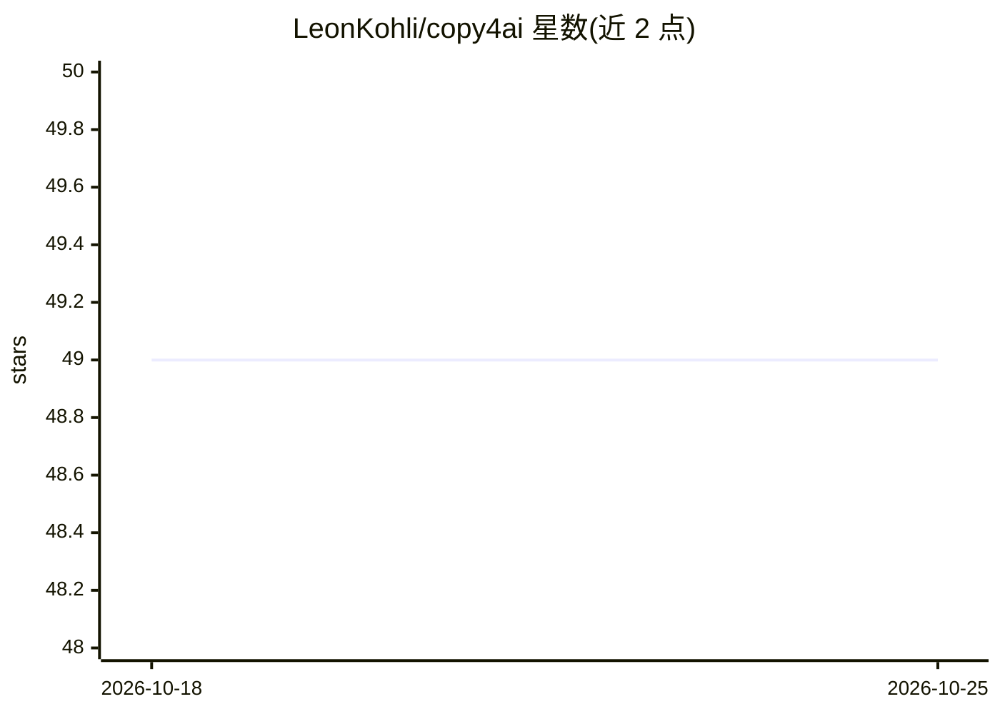

# LeonKohli/copy4ai

⭐ 49 · JavaScript · GPL-3.0 · 推送 2026-10-01 · [GitHub](https://github.com/LeonKohli/copy4ai) · [官网](https://copy4ai.dev) · 个人维护

**VS Code 扩展：把选中文件与项目树复制成可粘贴给 LLM 的内容**

面向向 ChatGPT、Claude、Gemini 等 LLM 提供代码上下文的 VS Code 扩展：右键文件或文件夹，将其内容连同项目树以 Markdown/XML/纯文本格式复制到剪贴板。默认排除点文件、.gitignore 匹配项与 node_modules，二进制与超 1 MB 文件仅留占位注释。支持复制 Git 变更 diff、本地离线 token 计数与警告阈值、路径/模式排除配置。不做网络请求、不采集遥测，读取与写入均在本地完成。可从 VS Code Marketplace 与 Open VSX 安装。

## 筛选速览

| 维度 | 判定 | 备注 |
|---|---|---|
| AI 角色 | `ai-enhanced` | 去掉 AI 部分产品仍成立 |
| 许可风险 | `viral` | GPL-3.0 |
| 部署形态 | `None` |  |
| 模型依赖 | — | README 未给出锁定关系 |
| 硬件要求 | — | 无带数字的原话,不猜 |
| 安装摩擦 | `low` | 无编译、无系统依赖或容器化 |
| 成熟度 | — | 结构信号不足 |

## 能力要点

- 复制选中文件内容+项目树为 Markdown/XML/纯文本三种格式
- 默认排除点文件、.gitignore 匹配与 node_modules，大文件留占位注释
- Copy Changes 生成对 HEAD 的 unified diff，降低 token 消耗
- 本地离线 token 计数，超 copy4ai.maxTokens 阈值时告警

## 适用场景

- 把项目源码整理成一段内容粘贴给 ChatGPT/Claude 做问答
- 只复制 Git 变更的 diff 让模型审查改动
- 粘贴前查看 token 数以控制上下文预算

## 场景标签

 · 领域:开发者工具/编辑器扩展

## 证据(README 行号)

> L8: Right-click files or folders in VS Code and copy their contents, with a project tree, as one block you can paste int
> L152: Copy4AI makes no network requests and collects no telemetry. It reads your files, writes the result to your clipbo

## 星数曲线

2026-10-18 49 → 2026-10-25 49（+0）

---
*卡片 v1 · prompt 1.4 · 生成 2026-10-24 · 置信度 high · 依据 README sha `4e911a993b2e` · [字段定义](../../DATASET.md)*
