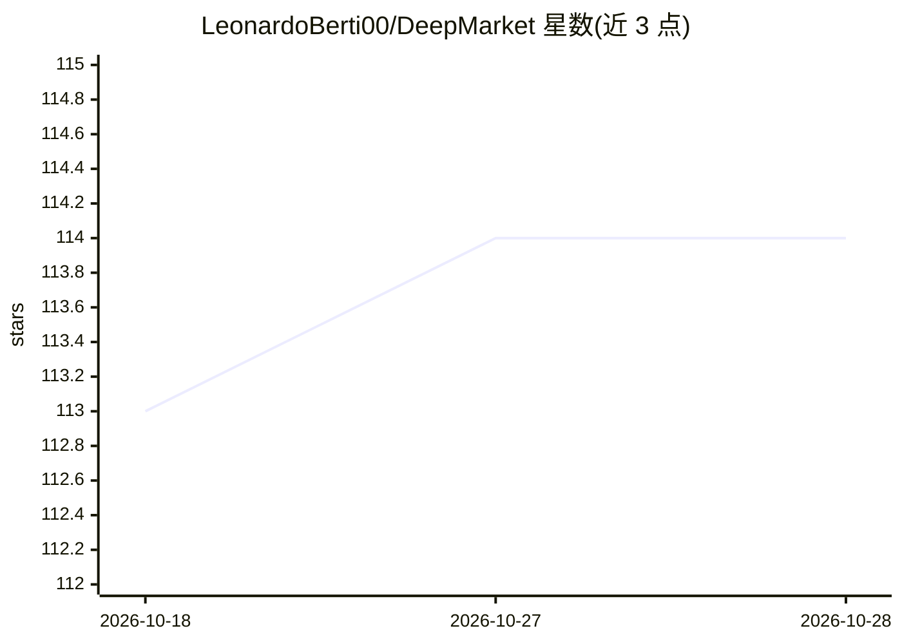

# LeonardoBerti00/DeepMarket

⭐ 114 · Python · MIT · 推送 2026-01-27 · [GitHub](https://github.com/LeonardoBerti00/DeepMarket) · 个人维护

**深度学习限价订单簿模拟框架，论文 TRADES 官方实现**

基于 Python 的限价订单簿（LOB）模拟开源框架，也是论文 TRADES（扩散模型生成市场模拟）的官方仓库。功能包括高频市场数据预处理、基于 PyTorch Lightning 的训练环境、WANDB 超参搜索、TRADES 与 CGAN 的实现及可下载 checkpoint（可直接生成模拟无需训练）、定性/定量评估，以及合成数据集 TRADES-LOB（TSLA/INTC，265,986 行）。模拟通过扩展 ABIDES 代理工具与历史数据交互执行。训练新模型需自备 LOBSTER 格式数据。

## 筛选速览

| 维度 | 判定 | 备注 |
|---|---|---|
| AI 角色 | `ai-native` | 本体是模型或模型工具 |
| 许可风险 | `permissive` | MIT |
| 部署形态 | `library` | 以包/库形式分发 |
| 模型依赖 | — | README 未给出锁定关系 |
| 硬件要求 | — | 无带数字的原话,不猜 |
| 安装摩擦 | `low` | 无编译、无系统依赖或容器化 |
| 成熟度 | — | 结构信号不足 |

## 能力要点

- 提供 TRADES 与 CGAN 的实现及 checkpoint，无需训练即可生成市场模拟
- 训练环境基于 PyTorch Lightning，超参搜索集成 WANDB
- 发布合成 LOB 数据集 TRADES-LOB（265,986 行、13,299,300 单元格）
- 基于 ABIDES 扩展的世界代理与历史数据交互模拟

## 适用场景

- 用预训练 checkpoint 直接生成限价订单簿模拟
- 复现论文 TRADES 的市场模拟实验与评估
- 基于 PyTorch Lightning 训练自己的 LOB 生成模型
- 用 TRADES-LOB 数据集做股价预测等下游金融任务

## 场景标签

`金融量化` `模型训练` · 领域:学习与行业

## 证据(README 行号)

> L2: DeepMarket is a Python-based open-source framework developed for Limit Order Book (LOB) simulation with Deep Learnin
> L10: 4. Implementations and checkpoints for TRADES and CGAN to directly generate market simulations without training.

## 星数曲线

2026-10-18 113 → 2026-10-28 114（+1）

---
*卡片 v1 · prompt 1.4 · 生成 2026-10-23 · 置信度 mid · 依据 README sha `eb77bf86989a` · [字段定义](../../DATASET.md)*
