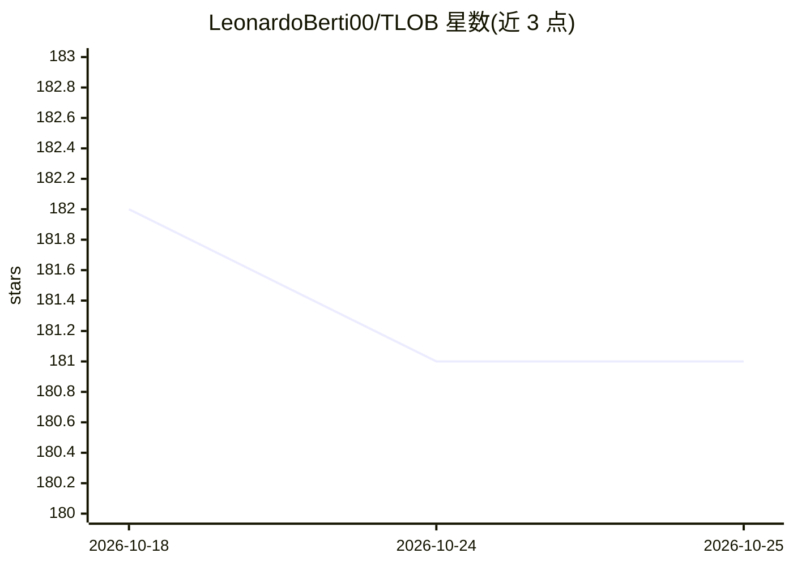

# LeonardoBerti00/TLOB

⭐ 181 · Python · MIT · 推送 2026-02-24 · [GitHub](https://github.com/LeonardoBerti00/TLOB) · 个人维护

**论文官方仓库：基于双重注意力 Transformer 的限价订单簿价格趋势预测模型**

TLOB 论文（arXiv:2502.15757）官方代码库，提供基于双注意力机制的 Transformer 模型，用于从限价订单簿（LOB）数据预测价格趋势，同时捕获空间与时间依赖。支持 FI-2010、BTC 与 LOBSTER 数据集训练测试（FI-2010/BTC 可自动下载，LOBSTER 需自备并预处理）。框架内还支持训练 DeepLOB、BiNCTABL、MLPLOB 等已有模型及用户新增模型，配置基于 Hydra，可选 wandb 记录与 sweep。环境要求 Windows + Python + pip，Linux/conda 使用不被官方支持。

## 筛选速览

| 维度 | 判定 | 备注 |
|---|---|---|
| AI 角色 | `ai-native` | 本体是模型或模型工具 |
| 许可风险 | `permissive` | MIT |
| 部署形态 | `library` | 以包/库形式分发 |
| 模型依赖 | — | README 未给出锁定关系 |
| 硬件要求 | — | 无带数字的原话,不猜 |
| 安装摩擦 | `low` | 无编译、无系统依赖或容器化 |
| 成熟度 | — | 结构信号不足 |

## 能力要点

- 双注意力 Transformer 处理 LOB 数据的价格趋势预测
- 同时支持训练 DeepLOB / BiNCTABL / MLPLOB 等已有模型
- FI-2010 与 BTC 数据集自动下载，兼容 LOBSTER 自备数据
- 提供新增模型接入流程（models/ 目录 + Hydra 配置）

## 适用场景

- 复现论文中的 LOB 价格趋势预测实验
- 在 FI-2010 / LOBSTER / BTC 数据集上训练对比多个 LOB 模型
- 在统一框架下实现并评测自己的 LOB 预测模型

## 场景标签

`金融量化` · 领域:学习与行业

## 证据(README 行号)

> L2: This is the official repository for the paper TLOB: A Novel Transformer Model with Dual Attention for Stock Price Tr
> L5: Price Trend Prediction (PTP) based on Limit Order Book (LOB) data is a fundamental challenge in financial markets. D

## 星数曲线

2026-10-18 182 → 2026-10-25 181（-1）

---
*卡片 v1 · prompt 1.4 · 生成 2026-10-22 · 置信度 mid · 依据 README sha `a60d49a88fbc` · [字段定义](../../DATASET.md)*
