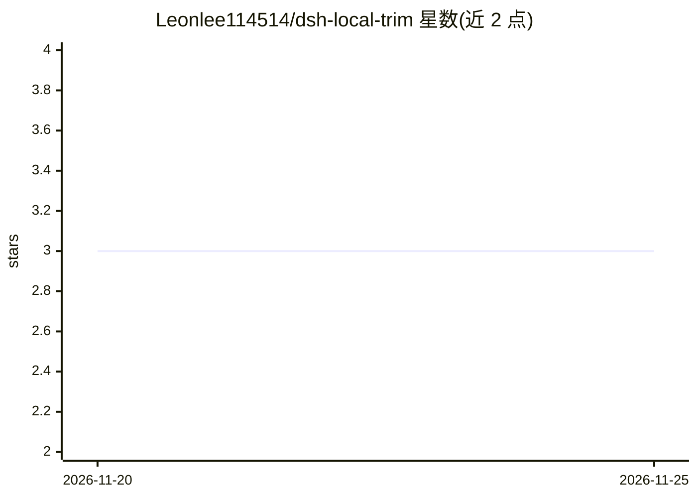

# Leonlee114514/dsh-local-trim

⭐ 3 · JavaScript · MIT · 推送 2026-11-17 · [GitHub](https://github.com/Leonlee114514/dsh-local-trim) · 个人维护 · 中文 README

**给本地小模型提供轻量裁剪的 DSH 插件**

DeepSeek Harness（DSH）的插件，面向本地模型场景：通过工具白名单限制、系统提示词分段过滤、注入正文替换为一页纸、工具 schema 描述截断四层手段收窄请求体积，缓解本地模型 16K–64K 上下文窗口下 `CONTEXT_WINDOW_EXCEEDED` 与工具调用正确率下降的问题。支持自动探测 llama.cpp/Ollama/vLLM/LM Studio 端点并写入 provider 配置，云端 provider 不受影响。安装方式为 npm 包、github 源（需 git）或本地 link，安装后经 `dsh plugin add` 挂载。

## 筛选速览

| 维度 | 判定 | 备注 |
|---|---|---|
| AI 角色 | `ai-ecosystem` | LLM/agent 周边工具 |
| 许可风险 | `permissive` | MIT |
| 部署形态 | `desktop` | 安装包/桌面程序 |
| 模型依赖 | local-ok | 支持本地模型 |
| 硬件要求 | — | 无带数字的原话,不猜 |
| 安装摩擦 | `low` | 无编译、无系统依赖或容器化 |
| 成熟度 | — | 结构信号不足 |

## 能力要点

- 四层裁剪：工具面、提示词分段、注入替换、schema 描述截断
- 自动探测本地端点（8090/11434/8000/1234）并写入 provider 配置
- 云端 provider 隔离：未命中路由时撤销限制、原对象返回
- DSH Web 插件详情页控制面板：状态徽章、裁剪收益、模型对齐与对账

## 适用场景

- 本地小模型窗口装不下上百工具描述时做请求瘦身
- 在 DSH 中同时使用云端与本地模型且互不影响
- 管理本地 provider 配置：试跑、对齐、清理失效模型条目

## 场景标签

`提示工程` `推理引擎` · 领域:Agent 开发

## 证据(README 行号)

> L3: 给本地小模型一套**轻量 harness**：让 llama.cpp / Ollama / vLLM / LM Studio 这类本地端点也能在
> L27: 唯一原语是 `tools.restrict({ allow })`，它把限制追加到调用者所在 scope 的层，**只影响该 agent
> L210: 先把模型挂进 DSH 的 `llm-pi-ai` provider，本插件负责裁剪。四种后端都走 OpenAI 兼容接口，

## 星数曲线

2026-11-20 3 → 2026-11-25 3（+0）

---
*卡片 v1 · prompt 1.4 · 生成 2026-11-22 · 置信度 high · 依据 README sha `7029caf0d197` · [字段定义](../../DATASET.md)*
