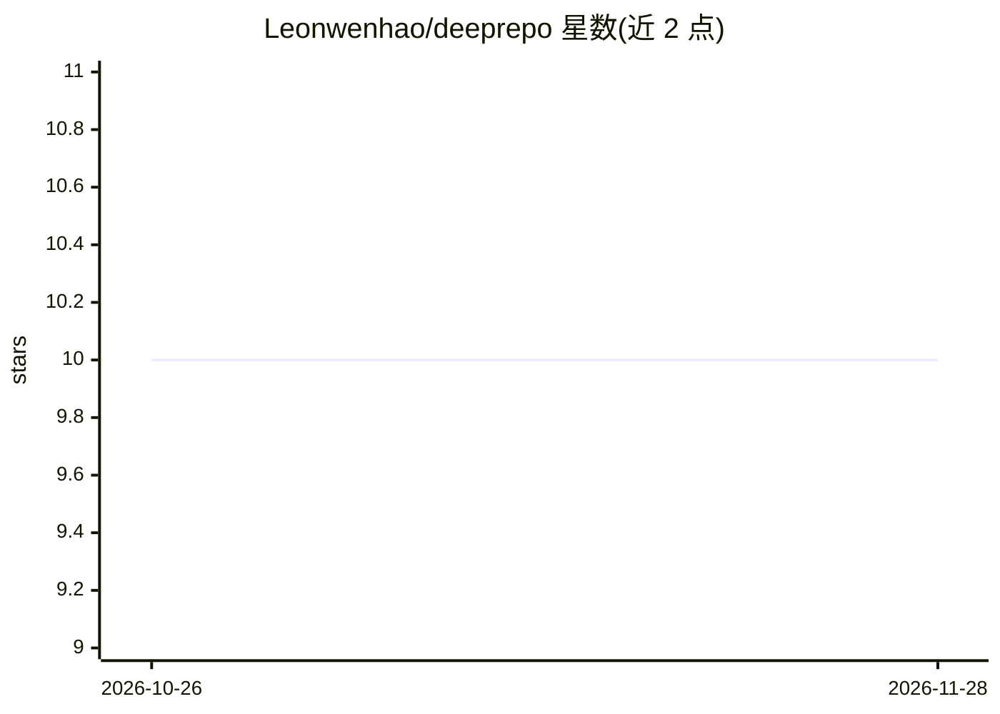

# Leonwenhao/deeprepo

⭐ 10 · Python · MIT · 推送 2026-02-26 · [GitHub](https://github.com/Leonwenhao/deeprepo) · 个人维护

**为 AI 编码工具生成可粘贴项目记忆的 CLI**

DeepRepo 是一个 Python CLI/TUI 工具：用递归多模型编排（root 编排模型写 Python REPL 探索代码库，把具体文件分析分派给 OpenRouter 上的廉价子模型）一次性分析项目，生成 `.deeprepo/` 目录，包含项目说明、压缩上下文提示、会话日志等文件。用户通过 `deeprepo context --copy` 复制上下文，粘贴到接受文本的任意 AI 编码工具中。需 Python 3.11、Anthropic 与 OpenRouter 双 API key，按项目收取约 $0.4–1 的模型调用费用。

## 筛选速览

| 维度 | 判定 | 备注 |
|---|---|---|
| AI 角色 | `ai-native` | 本体是模型或模型工具 |
| 许可风险 | `permissive` | MIT |
| 部署形态 | `library` | 以包/库形式分发 |
| 模型依赖 | locked-api |  |
| 硬件要求 | — | 无带数字的原话,不猜 |
| 安装摩擦 | `low` | 无编译、无系统依赖或容器化 |
| 成熟度 | — | 结构信号不足 |

## 能力要点

- 生成 `.deeprepo/` 项目记忆目录（PROJECT.md/COLD_START.md/SESSION_LOG.md 等）
- 递归语言模型（RLM）模式：root 模型程序化导航代码库，分派子任务给 sub-LLM
- 交互式 TUI 与非交互 CLI 双模式，命令可脚本化用于 CI
- 通过 DomainConfig 支持代码/内容/通用文档三种可插拔分析域

## 适用场景

- 避免每次向 Claude Code、Cursor 等工具重复解释项目架构
- 大型代码库的架构与技术债一次性分析
- 团队内复用统一的项目上下文配置（Teams）

## 场景标签

`多智能体` `编码 Agent` · 领域:Agent 开发

## 证据(README 行号)

> L10: DeepRepo analyzes your codebase using recursive multi-model orchestration, then generates a `.deeprepo/` directory 
> L122: Under the hood, DeepRepo implements the Recursive Language Model pattern. A root LLM (Claude Sonnet 4.6) writes Py

## 星数曲线

2026-10-26 10 → 2026-11-28 10（+0）

---
*卡片 v1 · prompt 1.4 · 生成 2026-11-20 · 置信度 high · 依据 README sha `dca785833261` · [字段定义](../../DATASET.md)*
