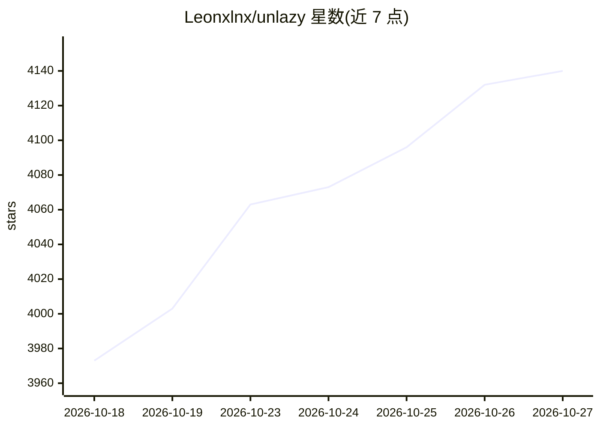

# Leonxlnx/unlazy

⭐ 4,140 · JavaScript · MIT · 推送 2026-09-03 · [GitHub](https://github.com/Leonxlnx/unlazy) · 个人维护

**给 AI agent 的反偷懒技能：验收台账先行、可运行门禁与复审**

以 SKILL.md 为核心的 agent 技能包，通过“深度树”方法将任务分层展开并为叶子分配时间预算，约束 agent 先写验收台账、执行经审批的 shell 门禁检查、复审已完成项，只报告有证据支持的结果。附带 gate-check.mjs 检查器（Node 16+、零第三方运行时依赖）、SHA-256 证据摘要、审批目录安全边界、scoped 并行编排与可选的 Claude Code Stop hook。经 npx skills CLI 或手动克隆到 Claude Code / Codex CLI 技能目录安装，2.1.0 尚未打 tag，需固定 commit 安装。

## 筛选速览

| 维度 | 判定 | 备注 |
|---|---|---|
| AI 角色 | `ai-ecosystem` | LLM/agent 周边工具 |
| 许可风险 | `permissive` | MIT |
| 部署形态 | `library` | 以包/库形式分发 |
| 模型依赖 | — | README 未给出锁定关系 |
| 硬件要求 | — | 无带数字的原话,不猜 |
| 安装摩擦 | `low` | 无编译、无系统依赖或容器化 |
| 成熟度 | `idea` | |

## 能力要点

- 验收台账（GATES.md）+ 可运行门禁检查器 gate-check.mjs
- 审批记录绑定 CHECK/EXPECT/CWD/shell/PATH 等完整上下文，修改需重新审批
- scoped 流水线编排：叶子状态机、OWNS 路径声明与租约协调、--jobs 并行上限
- 可选 Claude Code Stop hook：门禁未满足时返回 decision:block

## 适用场景

- 约束 agent 在大型重构/多步任务中不提前收工、逐项过验收门禁
- 在 Claude Code 会话结束时强制拦截未通过验证的工作
- 多分支并行任务中用声明式路径所有权协调多个 agent 叶子任务

## 场景标签

`提示工程` · 领域:Agent 开发

## 证据(README 行号)

> L32: The core is SKILL.md. The checker and optional hook require Node 16 or newer and use no third-party runtime package
> L134: ## Optional Claude Code Stop hook

## 星数曲线

2026-10-18 3,973 → 2026-10-27 4,140（+167）

---
*卡片 v1 · prompt 1.4 · 生成 2026-10-20 · 置信度 high · 依据 README sha `a26b3cd46e69` · [字段定义](../../DATASET.md)*
