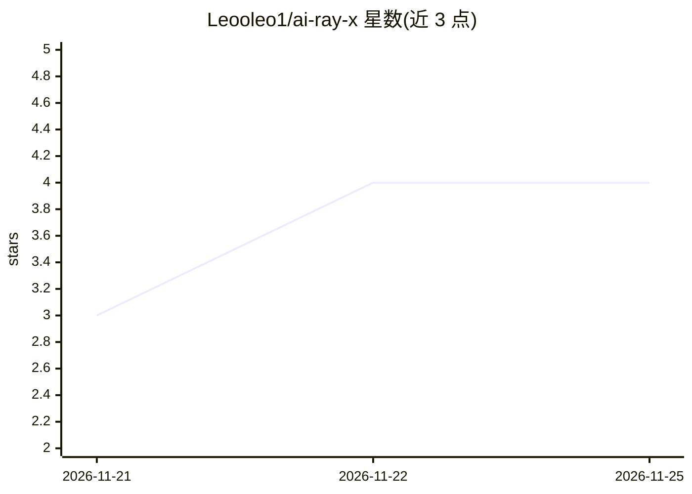

# Leooleo1/ai-ray-x

⭐ 4 · Rust · MIT · 推送 2026-11-21 · [GitHub](https://github.com/Leooleo1/ai-ray-x) · 个人维护

**本地面板统一管理各项目中的 AI 编码 agent 并追踪 token 消耗**

基于 Tauri/Rust 的本地桌面应用（仅监听 127.0.0.1），在一个面板中为每个项目运行 Claude Code、Codex、Cursor、Antigravity、opencode 等 CLI agent，使用用户自己的账号登录。提供 Bot 卡片、Desk 四栏任务板、Deliveries 产出记录、Wiki 共享页面与 Workflow 编排；每种 agent 有 allow/approve for me/auto/full 四种权限模式。Consumption 三个页面读取 Claude Code 与 Codex 的本地日志，按天/agent/模型/项目展示费用估算，并给出带备份与撤销的 token 节省措施。提供 macOS/Windows 安装包，Intel Mac 与 Linux 需从源码构建。

## 筛选速览

| 维度 | 判定 | 备注 |
|---|---|---|
| AI 角色 | `ai-ecosystem` | LLM/agent 周边工具 |
| 许可风险 | `permissive` | MIT |
| 部署形态 | `None` |  |
| 模型依赖 | — | README 未给出锁定关系 |
| 硬件要求 | — | 无带数字的原话,不猜 |
| 安装摩擦 | `low` | 无编译、无系统依赖或容器化 |
| 成熟度 | `idea` | |

## 能力要点

- 一个面板并行管理每个项目各自的 AI agent，含四栏任务板与工作流编排
- 读取 Claude Code 与 Codex 本地日志，按天/AI/模型/项目统计 token 与费用估算
- ranked token 节省措施（如 compact 阈值）带备份、撤销与事后测量
- 本地运行不上传数据，支持手机 QR 配对与 Telegram 接入

## 适用场景

- 多个项目同时让 AI 编码 agent 工作，并统一查看各 agent 状态与产出
- 追踪各 AI 编码工具的 token 花费并找到降低开销的切法
- 通过任务板和工作流安排 agent 定时或接力执行任务

## 场景标签

`编码 Agent` · 领域:编码与开发

## 证据(README 行号)

> L10: It runs the CLIs you already use, under your own accounts: **Claude Code,
> L12: provider, free models included). And it shows where their tokens go, with cuts
> L120: **Usage.** What your AIs' use would cost at API prices: per day, per AI, per

## 星数曲线

2026-11-21 3 → 2026-11-25 4（+1）

---
*卡片 v1 · prompt 1.4 · 生成 2026-11-22 · 置信度 high · 依据 README sha `c9e3dc286209` · [字段定义](../../DATASET.md)*
