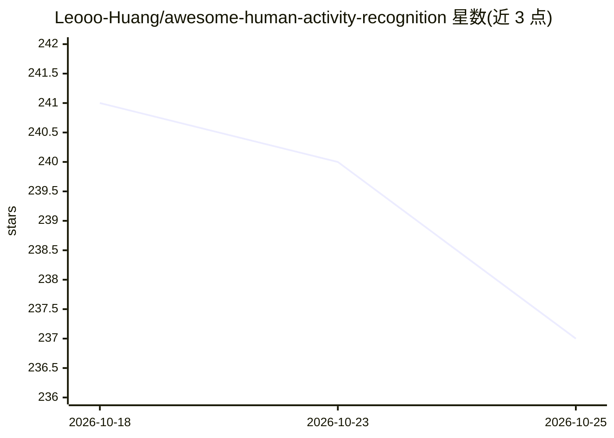

# Leooo-Huang/awesome-human-activity-recognition

⭐ 237 · Python · CC-BY-4.0 · 推送 2026-10-21 · [GitHub](https://github.com/Leooo-Huang/awesome-human-activity-recognition) · [官网](https://leooo-huang.github.io/awesome-human-activity-recognition/) · 个人维护 · 中文 README

**人体活动识别（HAR）研究资源清单：数据集、框架、模型、教程**

面向 HAR 研究者的 awesome 类策展清单：按视觉、骨架/动作捕捉、可穿戴传感器、多模态/自我中心、新兴前沿五类收录 50 余个数据集，并整理视频与骨架动作识别框架、可穿戴 HAR 库、动作生成与估计模型、预训练模型、教程课程与经典论文。提供按模态和任务选择数据集的推荐路径（如视频分类用 Kinetics-700 预训练、UCF-101 评测；骨架用 NTU RGB+D 120；IMU 用 UCI-HAR 等）。内容声称持续从 Papers with Code 自动扫描更新。

## 筛选速览

| 维度 | 判定 | 备注 |
|---|---|---|
| AI 角色 | `ai-knowledge` | 知识聚合/清单类 |
| 许可风险 | `viral` | CC-BY-4.0 |
| 部署形态 | `None` |  |
| 模型依赖 | — | README 未给出锁定关系 |
| 硬件要求 | — | 无带数字的原话,不猜 |
| 安装摩擦 | `low` | 无编译、无系统依赖或容器化 |
| 成熟度 | — | 结构信号不足 |

## 能力要点

- 覆盖视觉/骨架/可穿戴/多模态/新兴五类共 50+ 数据集
- 按模态和任务给出数据集选择推荐路径
- 收录 MMAction2、PySlowFast、tsai 等框架与预训练模型
- 包含教程、课程与经典论文条目

## 适用场景

- 按数据模态挑选合适的 HAR 数据集
- 查找动作识别框架与预训练模型
- 入门 HAR 领域的教程与论文线索

## 场景标签

`精选清单` · 领域:学习与行业

## 证据(README 行号)

> L7: > Human Activity Recognition (HAR) is the field of recognizing human actions and activities from sensor data — inclu
> L29: ## Datasets

## 星数曲线

2026-10-18 241 → 2026-10-25 237（-4）

---
*卡片 v1 · prompt 1.4 · 生成 2026-10-22 · 置信度 high · 依据 README sha `f9ab7a321b87` · [字段定义](../../DATASET.md)*
