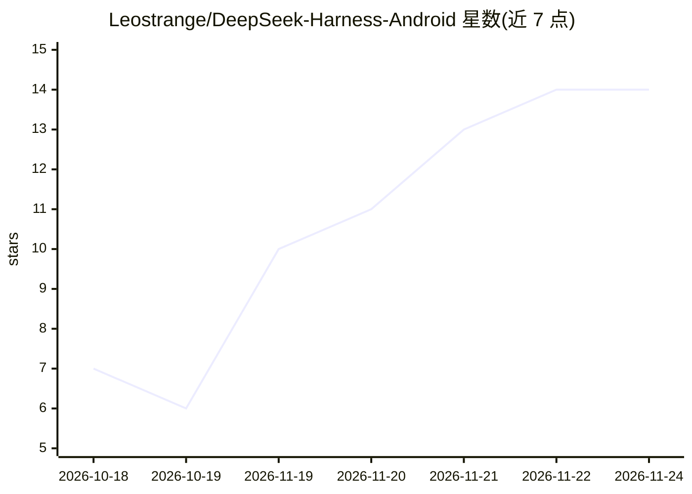

# Leostrange/DeepSeek-Harness-Android

⭐ 14 · Kotlin · 推送 2026-11-13 · [GitHub](https://github.com/Leostrange/DeepSeek-Harness-Android) · 个人维护

**DeepSeek Harness Android 的俄语化分支：安卓端 AI Agent 客户端**

基于 DSH-APP/DSHA 的俄语本地化发行版，为 Android 11+ / arm64-v8a 提供 DeepSeek Harness（AI Agent 应用）的 APK。本仓库贡献集中在俄语翻译（安装、诊断、恢复、设置页）、移动端界面布局修复与内置插件描述补全，修复设置页溢出、键盘高度变化、侧边栏重复按钮等问题。源码以发布附件 zip 形式提供，上游 PR #253 处于 Draft 状态；覆盖安装要求包名与签名证书一致，签名密钥不公开。

## 筛选速览

| 维度 | 判定 | 备注 |
|---|---|---|
| AI 角色 | `ai-native` | 本体是模型或模型工具 |
| 许可风险 | `none` | — |
| 部署形态 | `None` |  |
| 模型依赖 | locked-api |  |
| 硬件要求 | — | 无带数字的原话,不猜 |
| 安装摩擦 | `low` | 无编译、无系统依赖或容器化 |
| 成熟度 | — | 结构信号不足 |

## 能力要点

- 提供 Android 11+ / arm64-v8a 的已签名 APK（build364）
- 俄语化 Android 客户端与 Web 界面的翻译与设置页修复
- 源码以发布附件 DSHA-0.2.2-RU-build364-source.zip 提供
- 向上游 DSH-APP/DSHA 提交 PR #253（Draft）

## 适用场景

- 在 Android 手机上运行 DeepSeek Harness Agent
- 俄语用户使用本地化界面的移动端 AI 客户端
- 跟踪上游俄语化补丁与修复进展

## 场景标签

`AI 助手` · 领域:对话与助手

## 证据(README 行号)

> L3: Русифицированная сборка DeepSeek Harness Android на базе DSH-APP/DSHA.
> L7: **DSHA 0.2.2 RU · build364** — Android11+ / arm64-v8a.

## 星数曲线

2026-10-18 7 → 2026-11-24 14（+7）

---
*卡片 v1 · prompt 1.4 · 生成 2026-11-20 · 置信度 high · 依据 README sha `2664e6537d47` · [字段定义](../../DATASET.md)*
