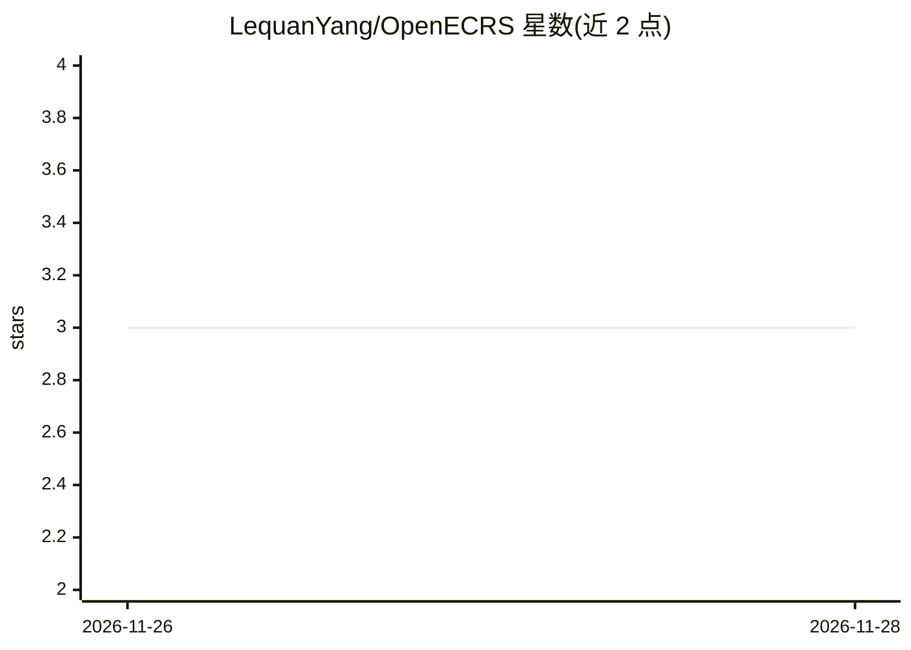

# LequanYang/OpenECRS

⭐ 3 · Python · 推送 2026-11-23 · [GitHub](https://github.com/LequanYang/OpenECRS) · 个人维护 · 中文 README

**面向开发者/投资者的 LLM 证据型选型机会评估 agent**

OpenECRS 是一个必须配置 LLM 才能运行的证据型推荐 agent：内置基于 52,007 条公开 AI 工具记录（Hacker News、GitHub、arXiv 等）清洗出的证据库（12 个场景、72 条引证），由确定性工具计算场景评分、排名、对比与 PoC 计划，LLM 仅负责规划与撰写回答，禁止生成数字。支持 OpenAI 兼容 API 或本地 Qwen2.5-3B + LoRA，可选本地 SearXNG 网页搜索，支持文档/图片上传与 OCR、多语言多角色回答、会话持久化与一页 PDF 简报。采集/清洗流水线不包含在本仓库内。

## 筛选速览

| 维度 | 判定 | 备注 |
|---|---|---|
| AI 角色 | `ai-native` | 本体是模型或模型工具 |
| 许可风险 | `none` | — |
| 部署形态 | `library` | 以包/库形式分发 |
| 模型依赖 | local-ok | 支持本地模型 |
| 硬件要求 | — | 无带数字的原话,不猜 |
| 安装摩擦 | `low` | 无编译、无系统依赖或容器化 |
| 成熟度 | — | 结构信号不足 |

## 能力要点

- LLM 必需、无模板回退：未配置模型时 /api/chat 返回 HTTP 428
- 确定性工具持有评分与引证，LLM 只规划与撰写（plan → tools → answer）
- 证据库含 45,306 条清洗记录、2,848 个高置信场景样本、72 条引证
- 文档/图片上传，长文档切换分块检索，图片走 Tesseract OCR

## 适用场景

- 评估某个 AI 应用场景是否值得立项并获取行动计划
- 按团队规模与预算生成验证/取舍的组合分配
- 按场景、来源、年份、置信度筛选引证证据并溯源原文
- 生成一页 PDF 决策简报用于团队汇报

## 场景标签

`数据分析` · 领域:效率与自动化

## 证据(README 行号)

> L4: An LLM-required agent that turns public AI-tooling signals into auditable, prioritised product opportunities.
> L31: 3. **An LLM agent** that plans the answer, calls those tools, and writes a one-sentence recommendation, supporting 
> L33: The LLM is **mandatory**. Without a configured model the agent refuses to chat; numbers, rankings and quotes always

## 星数曲线

2026-11-26 3 → 2026-11-28 3（+0）

---
*卡片 v1 · prompt 1.4 · 生成 2026-11-27 · 置信度 high · 依据 README sha `b98ef7119348` · [字段定义](../../DATASET.md)*
