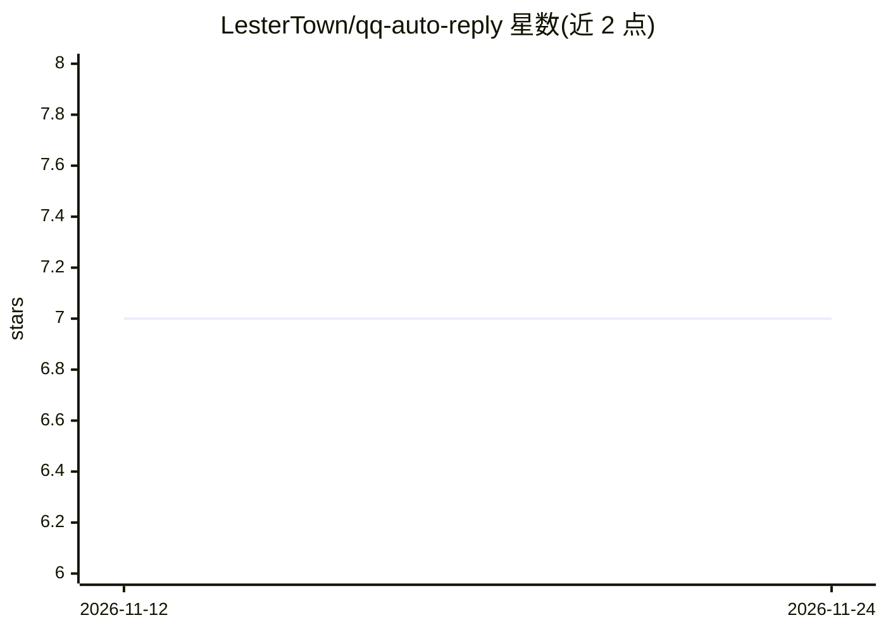

# LesterTown/qq-auto-reply

⭐ 7 · JavaScript · MIT · 推送 2026-11-11 · [GitHub](https://github.com/LesterTown/qq-auto-reply) · 个人维护 · 中文 README

**macOS 用户用 OCR+模拟操作让 LLM 自动回复 QQ 好友消息**

DeepSeek Harness（DSH）桌面端的插件：不接入 QQ 协议、不注入客户端，通过屏幕截图 OCR 读取新消息，调用 LLM 按 persona 生成回复，再用 CGEvent 模拟粘贴与回车发送，驱动的是真实登录的 QQ 主号窗口。以 5 秒心跳轮询运行，配置面板提供开关、目标好友、间隔、模型与人设；需授予屏幕录制、辅助功能与自动化权限；仅支持 macOS 新版 NT QQ。

## 筛选速览

| 维度 | 判定 | 备注 |
|---|---|---|
| AI 角色 | `ai-native` | 本体是模型或模型工具 |
| 许可风险 | `permissive` | MIT |
| 部署形态 | `None` |  |
| 模型依赖 | locked-api |  |
| 硬件要求 | — | 无带数字的原话,不猜 |
| 安装摩擦 | `low` | 无编译、无系统依赖或容器化 |
| 成熟度 | — | 结构信号不足 |

## 能力要点

- 屏幕 OCR + CGEvent 模拟键鼠驱动真实 QQ 窗口，无需协议或注入
- 可在设置面板配置模型、人设、回复间隔，volatile 热更新无需重启
- 注册 qq_send 工具，agent 可主动向任意好友发消息
- 同一套逻辑可复用到微信/飞书/钉钉等其他 IM

## 适用场景

- 用自己的 QQ 主号给指定好友自动聊天回复
- 避开协议机器人方案的封号风险
- 将 UI 自动化套路迁移到微信等桌面 IM

## 场景标签

`聊天机器人` `GUI 自动化` · 领域:效率与自动化

## 证据(README 行号)

> L3: **让你的 DeepSeek Harness（DSH）用你自己已登录的 QQ 账号，跟好友自动聊天。**
> L5: 不接协议、不注入客户端，只用 **屏幕 OCR + CGEvent 模拟键鼠**——把「人手操作 QQ」这件事自动化。
> L103: settings page turns it on; it then polls every `intervalSec`, detects the newest message via OCR, asks an LLM

## 星数曲线

2026-11-12 7 → 2026-11-24 7（+0）

---
*卡片 v1 · prompt 1.4 · 生成 2026-11-20 · 置信度 high · 依据 README sha `81d5687aba16` · [字段定义](../../DATASET.md)*
