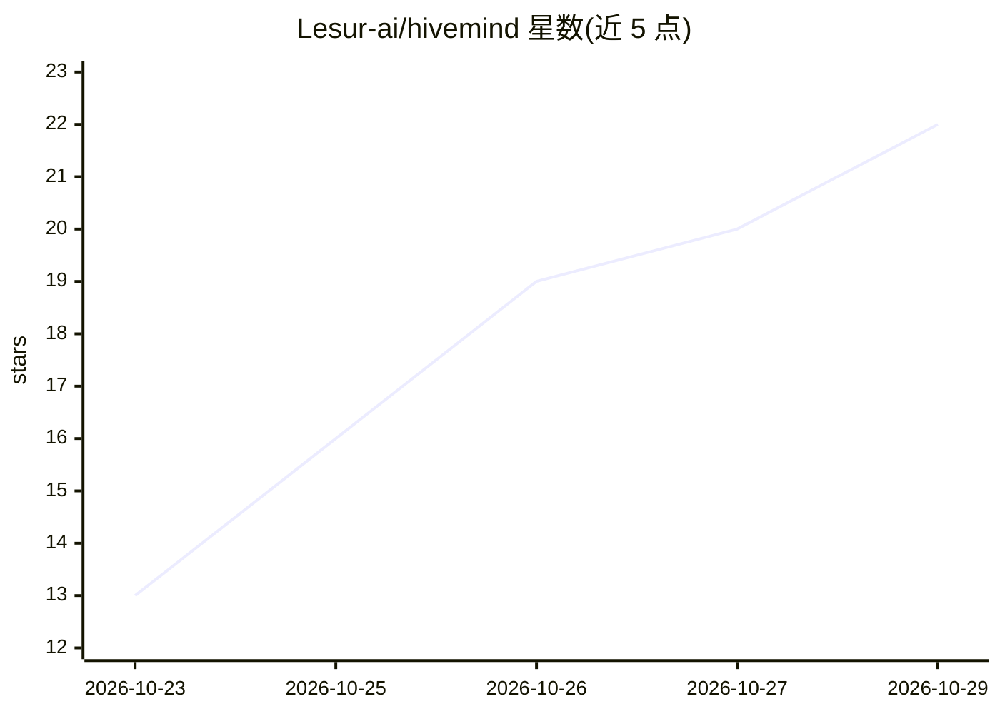

# Lesur-ai/hivemind

⭐ 22 · Python · Apache-2.0 · 推送 2026-10-26 · [GitHub](https://github.com/Lesur-ai/hivemind) · [官网](https://lesur.ai/hivemind) · 组织维护

**面向多 Agent 共享记忆的 MCP 记忆层服务（短/中/长三层）**

厂商中立的 MCP 服务，为项目提供跨 Agent 共享的三层记忆：short 共享便签、mid 整理为 Markdown 手册、long 由文档与 MID 内容派生知识图谱（语义检索）。任何 MCP 客户端以 scoped token 连接同一 space 读写记忆；Project Mesh 可将两套部署配对共享逻辑记忆（当前仅支持双节点）。以 Docker Compose 栈交付（含 WAF、Neo4j、Qdrant），需自备 S3 服务与 chat/embedding 模型凭证；提供 /admin Portal 管理、hivemind-ingest 文档摄取 CLI、Codex 与 Claude Code 集成指南。升级需重建镜像，1.6.3 备份格式与 1.6.2 不兼容。

## 筛选速览

| 维度 | 判定 | 备注 |
|---|---|---|
| AI 角色 | `ai-ecosystem` | LLM/agent 周边工具 |
| 许可风险 | `permissive` | Apache-2.0 |
| 部署形态 | `self-host` | docker 或自建部署 |
| 模型依赖 | locked-api |  |
| 硬件要求 | — | 无带数字的原话,不猜 |
| 安装摩擦 | `low` | 无编译、无系统依赖或容器化 |
| 成熟度 | `idea` | |

## 能力要点

- short/mid/long 三层记忆：便签→Markdown 综合→知识图谱语义检索
- 任何 MCP 客户端以 scoped token 共享同一 space 的项目记忆
- Project Mesh 双节点配对共享逻辑记忆（签名一次性邀请，3,600 秒有效）
- Docker Compose 全栈交付，含 WAF、Neo4j、Qdrant 与 /admin 管理界面

## 适用场景

- 多个 Agent 或团队在工具变更后保留并共享项目记忆
- 让不同 Agent 继承先前决策与知识，避免上下文手工复制
- 通过知识图谱按语义查找项目相关上下文

## 场景标签

`Agent 记忆` `多智能体` `知识图谱` `语义搜索` · 领域:Agent 开发

## 证据(README 行号)

> L7: Vendor-neutral, open-source MCP service for three-tier agent memory:
> L65: Hivemind gives the project its own memory. Any MCP-capable agent can connect
> L66: with a scoped token, work in the same `space_id`, and leave useful context for

## 星数曲线

2026-10-23 13 → 2026-10-29 22（+9）

---
*卡片 v1 · prompt 1.4 · 生成 2026-10-28 · 置信度 high · 依据 README sha `4cf4ed370448` · [字段定义](../../DATASET.md)*
