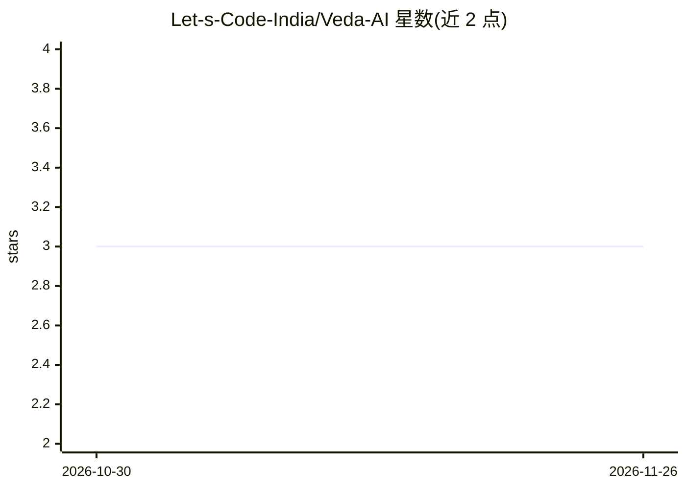

# Let-s-Code-India/Veda-AI

⭐ 3 · Python · MIT · 推送 2026-11-06 · [GitHub](https://github.com/Let-s-Code-India/Veda-AI) · [官网](https://let-s-code-india.github.io) · 个人维护

**自托管的 15 个专科 AI Agent 本地工作台**

以 Python/Flask Web 应用形式自托管的 AI 工作台：用户在浏览器中与 15 个面向编码、写作、辅导、翻译、图像理解、音视频转录等任务的内置专科 Agent 对话，支持路由自动选择 Agent、自定义 Agent 导入导出、文件与媒体处理。聊天记录与技能记忆存于本地 SQLite；模型请求发送至 Groq API，需免费 Groq key，非离线推理。提供 Linux/macOS/Termux shell 脚本与 Windows 批处理脚本安装，浏览器端可作 PWA 安装。

## 筛选速览

| 维度 | 判定 | 备注 |
|---|---|---|
| AI 角色 | `ai-native` | 本体是模型或模型工具 |
| 许可风险 | `permissive` | MIT |
| 部署形态 | `None` |  |
| 模型依赖 | locked-api |  |
| 硬件要求 | — | 无带数字的原话,不猜 |
| 安装摩擦 | `medium` | 含编译或系统依赖之一 |
| 成熟度 | — | 结构信号不足 |

## 能力要点

- 15 个内置专科 Agent 加自定义 Agent 定义导入导出
- 图像理解、PDF 文本抽取（pypdf）、音视频转录
- 聊天历史与技能记忆存于本地 SQLite，支持 PWA 安装
- Agent 模型深度（fast/balanced/deep）可在 .env 逐 Agent 配置

## 适用场景

- 在自己的电脑或服务器上运行个人 AI 助手团队
- 在 Android 手机上通过 Termux 或 PWA 使用多 Agent 对话
- 对 PDF、图片、音视频文件提问与转录

## 场景标签

`聊天机器人` `AI 助手` `文档问答` · 领域:对话与助手

## 证据(README 行号)

> L5: Veda AI is a self-hosted, local-first AI workspace. Run it as a Python web application on your own computer or serve
> L27: 3. Veda AI selects or uses the relevant specialist agent and calls the configured Groq model.
> L30: The server and database stay on the host running Veda AI, but prompts, attached content needed for inference, and t

## 星数曲线

2026-10-30 3 → 2026-11-26 3（+0）

---
*卡片 v1 · prompt 1.4 · 生成 2026-11-22 · 置信度 high · 依据 README sha `5e88cb37170f` · [字段定义](../../DATASET.md)*
