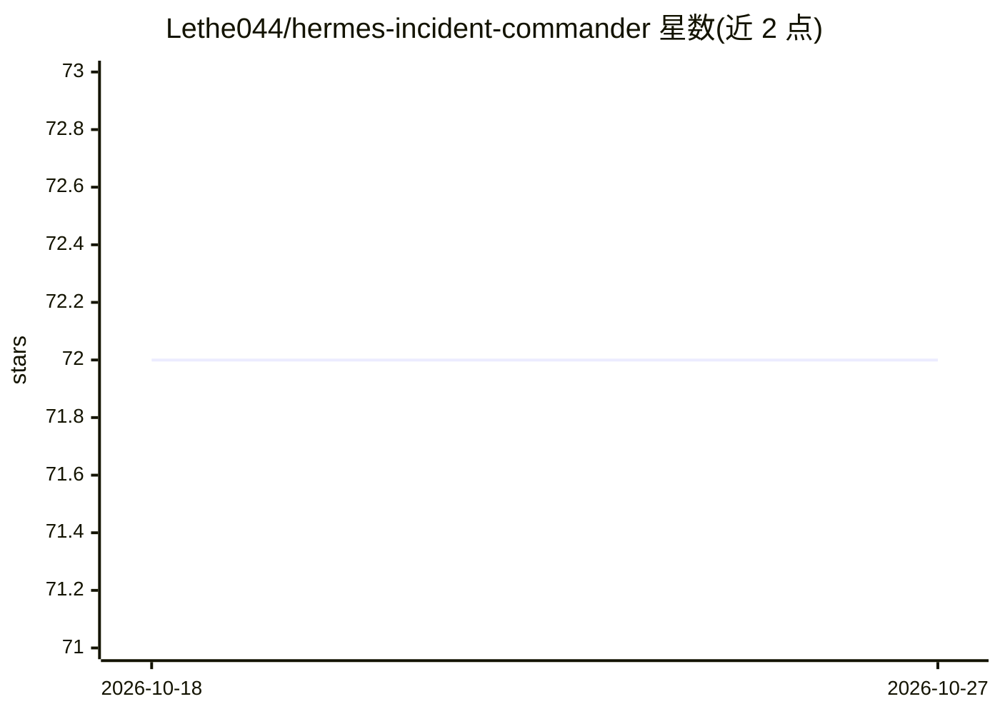

# Lethe044/hermes-incident-commander

⭐ 72 · Python · MIT · 推送 2026-09-21 · [GitHub](https://github.com/Lethe044/hermes-incident-commander) · 个人维护

**自主 SRE agent：检测、诊断并自愈生产环境事故**

构建于 Hermes Agent 之上的自主运维 agent：对事故分级（P0-P3），并行执行 CPU/内存/磁盘/服务诊断，识别根因并应用修复，写入结构化事后报告，并自动生成新的预防技能 SKILL.md。另提供独立 watchdog（monitor/watchdog.py），仅需 Anthropic API key 即可在任意 Linux 主机运行：用 psutil 采集指标发送给 Claude，不授予模型 shell 权限，修复动作限定于显式允许清单，支持 --dry-run、静默时段、flapping 检测、SQLite 事故索引、自包含 HTML 仪表盘与 Prometheus/Grafana 导出，告警可发 Discord/Slack/Teams/PagerDuty/Telegram。可选 Atropos RL 训练环境。

## 筛选速览

| 维度 | 判定 | 备注 |
|---|---|---|
| AI 角色 | `ai-native` | 本体是模型或模型工具 |
| 许可风险 | `permissive` | MIT |
| 部署形态 | `library` | 以包/库形式分发 |
| 模型依赖 | locked-api |  |
| 硬件要求 | — | 无带数字的原话,不猜 |
| 安装摩擦 | `low` | 无编译、无系统依赖或容器化 |
| 成熟度 | — | 结构信号不足 |

## 能力要点

- 事故检测→根因分析→自动修复→事后报告→预防技能生成的闭环
- 独立 watchdog 仅需 ANTHROPIC_API_KEY，无 shell 权限、修复限定允许清单、支持 --dry-run
- SQLite/FTS5 事故索引与自包含 HTML 仪表盘、Prometheus /metrics 导出
- 每小时段自适应阈值（只升不降、上限 1.5x）与 flapping 检测

## 适用场景

- 夜间无人值守时自动检测并修复生产服务器事故
- 为 Linux 主机部署带允许清单控制的安全自动修复看门狗
- 汇总事故历史并生成仪表盘供周会复盘

## 场景标签

`工作流自动化` · 领域:效率与自动化

## 证据(README 行号)

> L8: > **An autonomous SRE agent that detects, diagnoses, and heals production infrastructure - then learns from every in
> L42: - Hermes detects the incident and classifies severity (P0/P1/P2/P3)
> L73: shell access**. It collects real metrics with `psutil`, sends only numbers to

## 星数曲线

2026-10-18 72 → 2026-10-27 72（+0）

---
*卡片 v1 · prompt 1.4 · 生成 2026-10-24 · 置信度 high · 依据 README sha `b23b2b3c90c3` · [字段定义](../../DATASET.md)*
