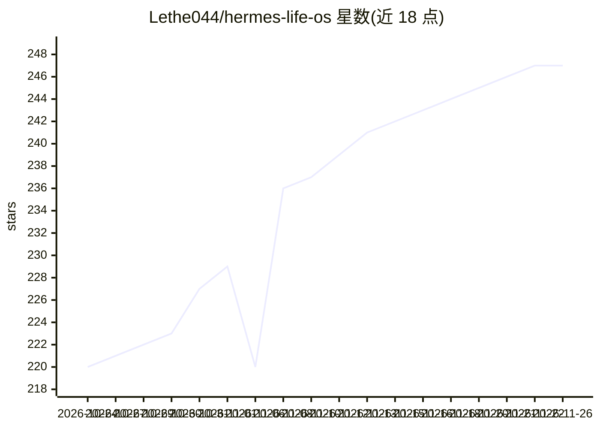

# Lethe044/hermes-life-os

⭐ 247 · Python · MIT · 推送 2026-11-24 · [GitHub](https://github.com/Lethe044/hermes-life-os) · 个人维护

**本地优先的个人生活管理 OS：记录心情睡眠习惯并由 Agent 联结数据**

基于 Python 的本地优先个人生活管理工具，覆盖心情、睡眠、营养、习惯、目标、财务等 14 类追踪，内置 313 个工具，通过自然语言调用。由 LLM Agent 生成每日简报、晚间反思与每周回顾，用 Pearson 相关（含 1-2 天滞后分析）发现数据间模式。数据存于本地 ~/.hermes/，可选加密，无需注册账号；支持多档案与多用户隔离、插件扩展。支持 pip/Docker/源码三种运行方式，也可完全脱离语言模型仅用 CLI 操作工具。

## 筛选速览

| 维度 | 判定 | 备注 |
|---|---|---|
| AI 角色 | `ai-enhanced` | 去掉 AI 部分产品仍成立 |
| 许可风险 | `permissive` | MIT |
| 部署形态 | `self-host` | docker 或自建部署 |
| 模型依赖 | local-ok | 支持本地模型 |
| 硬件要求 | — | 无带数字的原话,不猜 |
| 安装摩擦 | `low` | 无编译、无系统依赖或容器化 |
| 成熟度 | — | 结构信号不足 |

## 能力要点

- 313 个可调用工具，覆盖追踪、规划、回顾全流程
- 相关引擎用纯 Python stdlib 计算同时与滞后相关系数
- 多档案/多用户数据隔离，PBKDF2 哈希存储 API key
- 插件系统：放入 .py 文件即被 Agent 调用，无需改核心代码

## 适用场景

- 记录心情、睡眠、饮食并让 Agent 生成每日简报
- 让 Agent 检测睡眠与情绪之间的关联模式
- 家庭成员共享一套安装但数据互相隔离
- 用本地 Ollama 实现无 API key 的免费运行

## 场景标签

`知识库管理` · 领域:知识与检索

## 证据(README 行号)

> L12: **The personal OS that grows with you.** Track how you feel, plan your day, keep your life
> L163: ### Use it without an AI model
> L113: `demo/analytics.py` computes real Pearson correlation coefficients between

## 星数曲线

2026-10-24 220 → 2026-11-26 247（+27）

---
*卡片 v1 · prompt 1.4 · 生成 2026-11-25 · 置信度 high · 依据 README sha `356a070d97f7` · [字段定义](../../DATASET.md)*
