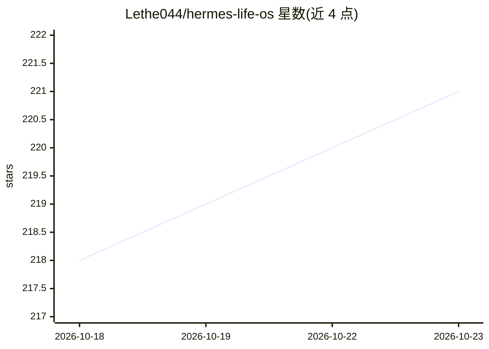

# Lethe044/hermes-life-os

⭐ 221 · Python · MIT · 推送 2026-10-21 · [GitHub](https://github.com/Lethe044/hermes-life-os) · 个人维护

**个人生活追踪 OS：用 agent 记录情绪/睡眠/饮食并生成洞察**

为 NousResearch Hermes Agent 黑客松构建的个人生活操作系统：以 CLI 对话方式记录情绪、睡眠、饮食、健身、专注、习惯等 14 类数据，agent 在每次回复前召回记忆，通过定时任务在早/午/晚/每周生成简报，并用 Pearson 相关与滞后相关引擎检测指标间的模式。支持四种 LLM 后端自动检测（含 Ollama 全本地免费路径），提供 Docker 镜像、多用户/多配置文件隔离、插件系统与可选的静态加密（PBKDF2+Fernet，无密码恢复机制）。

## 筛选速览

| 维度 | 判定 | 备注 |
|---|---|---|
| AI 角色 | `ai-native` | 本体是模型或模型工具 |
| 许可风险 | `permissive` | MIT |
| 部署形态 | `self-host` | docker 或自建部署 |
| 模型依赖 | local-ok | 支持本地模型 |
| 硬件要求 | — | 无带数字的原话,不猜 |
| 安装摩擦 | `low` | 无编译、无系统依赖或容器化 |
| 成熟度 | — | 结构信号不足 |

## 能力要点

- 14 类生活数据的对话式记录与记忆召回
- 同日与滞后 Pearson 相关引擎自动检测模式（|r|≥0.4，纯标准库）
- 定时 cron 简报（07:00/12:00/18:00/23:00 与周一回顾）
- 多配置文件/多用户隔离与静态加密、插件扩展

## 适用场景

- 用对话记录情绪、睡眠、饮食并获取每日简报
- 发现睡眠、压力、情绪等指标间的相关模式
- 家庭成员共享一套安装且数据互相隔离

## 场景标签

`AI 助手` · 领域:对话与助手

## 证据(README 行号)

> L13: > Built for the NousResearch "Show us what Hermes Agent can do" hackathon.
> L42: |**Memory**|Stores every mood, meal, sleep entry, workout, stress log - recalls before every response|
> L47: |**Atropos RL**|Reward function trains Hermes to be more personal and memory-driven over time|

## 星数曲线

2026-10-18 218 → 2026-10-23 221（+3）

---
*卡片 v1 · prompt 1.4 · 生成 2026-10-22 · 置信度 high · 依据 README sha `79b7600bca09` · [字段定义](../../DATASET.md)*
