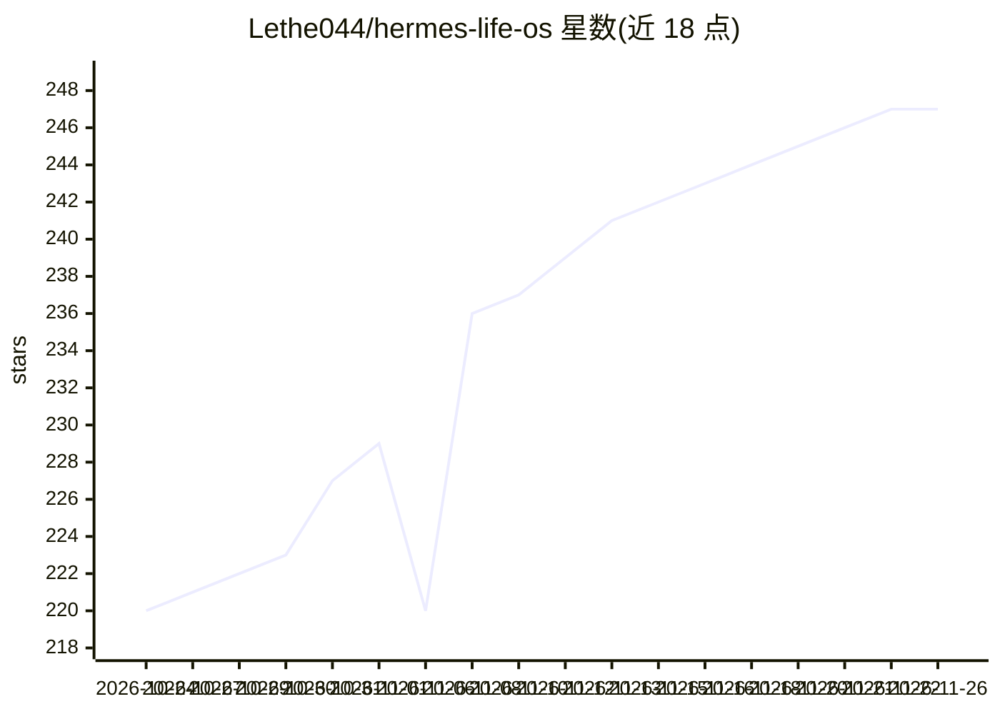

# Lethe044/hermes-life-os

⭐ 247 · Python · MIT · 推送 2026-11-24 · [GitHub](https://github.com/Lethe044/hermes-life-os) · 个人维护

**本地优先的个人生活管理 OS：记录与规划生活，agent 从你的数据中给出洞察**

以 Python 包、CLI 与 Docker 形式提供的本地优先生活管理工具：追踪情绪、睡眠、营养、习惯、任务、财务等 14 类数据，agent 通过 317 个工具响应自然语言指令，生成每日简报（07:00/12:00/18:00/23:00 定时）与每周回顾；相关性引擎用纯 Python 标准库计算皮尔逊相关与滞后相关（|r|>=0.4、4 天以上数据才呈现）。支持四种 LLM 后端自动检测，也可完全脱离语言模型从 shell 直接调用工具。基于 NousResearch 黑客松的 Hermes agent 构建，含多档案/多用户隔离与插件系统。

## 筛选速览

| 维度 | 判定 | 备注 |
|---|---|---|
| AI 角色 | `ai-native` | 本体是模型或模型工具 |
| 许可风险 | `permissive` | MIT |
| 部署形态 | `self-host` | docker 或自建部署 |
| 模型依赖 | local-ok | 支持本地模型 |
| 硬件要求 | — | 无带数字的原话,不猜 |
| 安装摩擦 | `low` | 无编译、无系统依赖或容器化 |
| 成熟度 | `idea` | |

## 能力要点

- 317 个工具覆盖习惯、睡眠、任务、财务、闪卡等生活管理功能
- 四种 LLM 后端自动检测，本地 Ollama 无需 API key
- 相关性引擎计算同日与滞后（1-2 天）皮尔逊相关，纯标准库实现
- 插件系统：放入 .py 文件即可让 agent 调用自定义工具

## 适用场景

- 用自然语言记录情绪、睡眠、饮食并由 agent 生成每日简报
- 自己在家做习惯实验（如戒咖啡对睡眠的影响）并让 agent 追踪相关性
- 家庭成员共享一套安装但各自数据隔离
- 不接任何语言模型，纯 CLI 管理任务与日程

## 场景标签

`AI 助手` `数据分析` · 领域:效率与自动化

## 证据(README 行号)

> L12: **The personal OS that grows with you.** Track how you feel, plan your day, keep your life
> L21: Ask in plain language; Hermes calls the right tool and answers from your own data.
> L168: Every tool also runs straight from the shell, with no language model and no API key:

## 星数曲线

2026-10-24 220 → 2026-11-26 247（+27）

---
*卡片 v1 · prompt 1.4 · 生成 2026-11-26 · 置信度 high · 依据 README sha `5de69ae8c168` · [字段定义](../../DATASET.md)*
