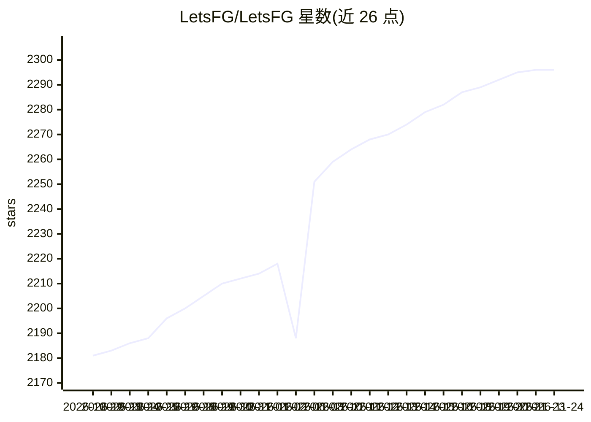

# LetsFG/LetsFG

⭐ 2,298 · Python · NOASSERTION · 推送 2026-11-15 · [GitHub](https://github.com/LetsFG/LetsFG) · [官网](https://letsfg.co) · 组织维护

**面向 AI agent 的机票与酒店搜索预订服务（MCP/CLI/SDK）**

LetsFG 提供机票与酒店的服务端搜索与真实预订：聚合航空公司官网及 Skyscanner、Kayak、Momondo 等比价来源，返回含总价的价格，价格不随重复搜索变动。接入方式包括：添加 https://letsfg.co/mcp 的 MCP server（支持 Claude connector 目录一键添加）、CLI（letsfg auth 走 OAuth 授权）、Python/JS SDK（本地运行开源排序算法）、直接调用 PFS HTTP 接口（search/poll/book/status）。预订在用户卡上冻结票价，由 LetsFG 预订代理出票并返回航司 PNR。Developer API 为面向高流量商业用途的付费产品。

## 筛选速览

| 维度 | 判定 | 备注 |
|---|---|---|
| AI 角色 | `ai-ecosystem` | LLM/agent 周边工具 |
| 许可风险 | `none` | NOASSERTION |
| 部署形态 | `library` | 以包/库形式分发 |
| 模型依赖 | — | README 未给出锁定关系 |
| 硬件要求 | — | 无带数字的原话,不猜 |
| 安装摩擦 | `low` | 无编译、无系统依赖或容器化 |
| 成熟度 | — | 结构信号不足 |

## 能力要点

- MCP server、CLI、Python/JS SDK、PFS HTTP API 四种接入路径
- 预订流程：卡上冻结票价→代理出票→返回航司 PNR，失败释放冻结
- 附带 /sandbox/flights/* 免费沙箱，可端到端模拟预订
- README 附与 Google Flights/Booking.com 的逐条同日比价表

## 适用场景

- 给我的 AI agent 接上机票酒店搜索和预订能力
- 写脚本直接调 PFS 接口自动查询航班
- 在自己的产品里集成 Developer API 做商业订票

## 场景标签

 · 领域:旅行/预订服务

## 证据(README 行号)

> L45: LetsFG gives your AI agent flight **and hotel** search and booking superpowers. Our server-side engine scans the en
> L49: **Claude:** LetsFG is in Claude's connector directory: add it there, no URL to paste. **Other agents:** add `https:
> L117: - **MCP / CLI / SDK (Path 1):** add `https://letsfg.co/mcp` as an MCP server in Claude, ChatGPT, Cursor or Windsur

## 星数曲线

2026-10-22 2,181 → 2026-11-24 2,296（+115）

---
*卡片 v1 · prompt 1.4 · 生成 2026-11-24 · 置信度 high · 依据 README sha `3fd83f361338` · [字段定义](../../DATASET.md)*
