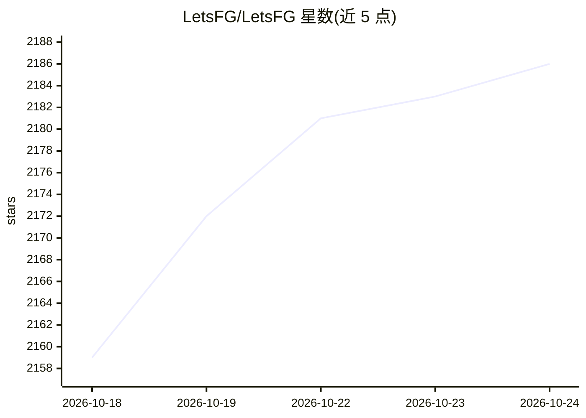

# LetsFG/LetsFG

⭐ 2,188 · Python · NOASSERTION · 推送 2026-10-21 · [GitHub](https://github.com/LetsFG/LetsFG) · [官网](https://letsfg.co) · 组织维护

**给 AI agent 用的机票酒店搜索与预订 MCP 服务及 SDK**

LetsFG 提供航班与酒店搜索及真实预订能力，形态包括 MCP 服务器（https://letsfg.co/mcp）、CLI、Python/JS SDK 及直接 HTTP API（PFS）。搜索免费运行在其服务器端；预订流程为先以 0.00 Revolut 设置挂卡（不扣款），由 LetsFG 预订代理出票并返回航司 PNR。接入需在 letsfg.co/connect 一次性授权获取 Bearer token，SDK 从环境变量或配置文件读取。另有面向高量商用集成的付费 Developer API（含沙箱与 /discover 端点），README 声明多数 agent 不需要。引擎声称覆盖全球航司及多个比价站点。

## 筛选速览

| 维度 | 判定 | 备注 |
|---|---|---|
| AI 角色 | `ai-ecosystem` | LLM/agent 周边工具 |
| 许可风险 | `none` | NOASSERTION |
| 部署形态 | `library` | 以包/库形式分发 |
| 模型依赖 | — | README 未给出锁定关系 |
| 硬件要求 | — | 无带数字的原话,不猜 |
| 安装摩擦 | `low` | 无编译、无系统依赖或容器化 |
| 成熟度 | — | 结构信号不足 |

## 能力要点

- MCP 服务器 + CLI + Python/JS SDK + PFS HTTP API 四种接入方式
- 搜索免费运行于服务端，预订经挂卡→代购→返回航司 PNR 流程
- 覆盖航班与酒店，提供 /discover 一次查 20 个目的地端点与端到端沙箱
- Developer API 为付费商用通道，含 200 次/预订的免费搜索额度

## 适用场景

- 在 Claude 等 MCP 客户端中用自然语言搜索并预订机票酒店
- 脚本或 agent 通过 Bearer token 调用 PFS API 完成搜索与预订
- 商业产品通过 Developer API 集成航班预订能力

## 场景标签

 · 领域:旅行/预订服务

## 证据(README 行号)

> L49: **Claude:** LetsFG is in Claude's connector directory: add it there, no URL to paste. **Other agents:** add `https:
> L108: ||**Path 1 — MCP / CLI / SDK**|**Path 2 — PFS** (Programmatic Flight Search via letsfg.co)|**Path 3 — Developer AP
> L117: - **MCP / CLI / SDK (Path 1):** add `https://letsfg.co/mcp` as an MCP server in Claude, ChatGPT, Cursor or Windsur

## 星数曲线

2026-10-18 2,159 → 2026-10-24 2,186（+27）

---
*卡片 v1 · prompt 1.4 · 生成 2026-10-21 · 置信度 mid · 依据 README sha `dd8e9bafd871` · [字段定义](../../DATASET.md)*
