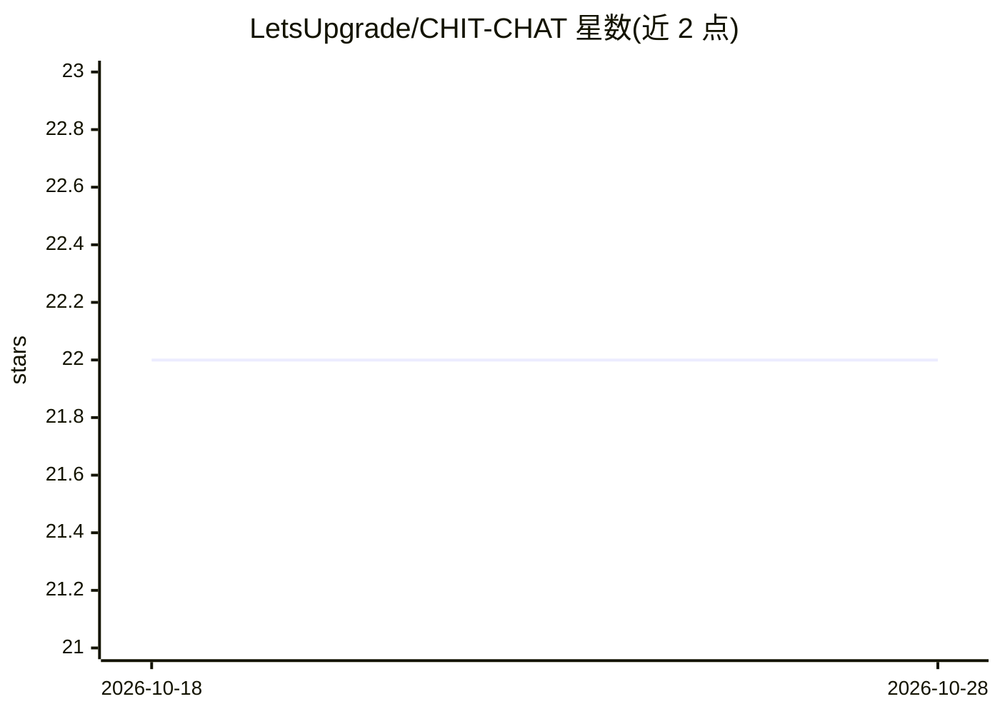

# LetsUpgrade/CHIT-CHAT

⭐ 22 · Python · 推送 2026-01-31 · [GitHub](https://github.com/LetsUpgrade/CHIT-CHAT) · 组织维护

**基于 Rasa 的 Covid-19 问答聊天机器人**

用 Rasa 框架与 TensorFlow 构建的机器学习对话机器人，面向普通用户的 Covid-19 相关查询：回答症状、预防措施、疫苗动态、附近医院等信息，并可判断用户是否可能感染。通过 rasa train 训练模型、rasa shell 启动对话、rasa run actions 运行自定义动作服务器；部署采用 Rasa X。README 未给出具体数据来源或准确率信息。

## 筛选速览

| 维度 | 判定 | 备注 |
|---|---|---|
| AI 角色 | `ai-native` | 本体是模型或模型工具 |
| 许可风险 | `none` | — |
| 部署形态 | `None` |  |
| 模型依赖 | — | README 未给出锁定关系 |
| 硬件要求 | — | 无带数字的原话,不猜 |
| 安装摩擦 | `low` | 无编译、无系统依赖或容器化 |
| 成熟度 | — | 结构信号不足 |

## 能力要点

- 基于 Rasa 框架与 TensorFlow 的对话管理
- 覆盖症状、疫苗、附近医院等 Covid-19 查询场景
- 提供本地训练/运行命令与 Rasa X 部署路径

## 适用场景

- 向机器人咨询 Covid-19 症状与预防措施
- 查询所在地疫情与疫苗动态信息
- 学习 Rasa 聊天机器人的训练与部署流程

## 场景标签

`聊天机器人` · 领域:对话与助手

## 证据(README 行号)

> L6: A bot that aims to serve humans queries and give an feasible answer to their queries. It is a machine-learning discu
> L16: The Covid-19 chatbot helps the users to get detailed information about Covid-19. Some of the features are identifyi

## 星数曲线

2026-10-18 22 → 2026-10-28 22（+0）

---
*卡片 v1 · prompt 1.4 · 生成 2026-10-27 · 置信度 mid · 依据 README sha `659909d2ada6` · [字段定义](../../DATASET.md)*
