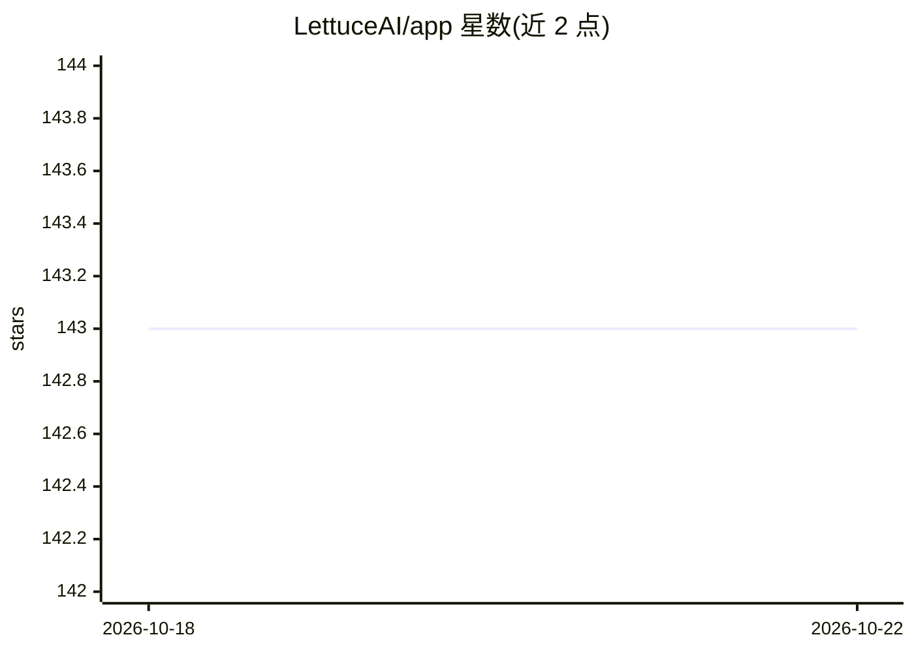

# LettuceAI/app

⭐ 143 · TypeScript · AGPL-3.0 · 推送 2026-10-21 · [GitHub](https://github.com/LettuceAI/app) · [官网](https://lettuceai.app) · 组织维护

**隐私优先的本地优先 AI 角色扮演与故事创作应用**

基于 Tauri/React 的开源 AI 角色聊天应用，面向角色扮演、故事创作与 AI 陪伴场景，支持长期记忆、自定义角色、图像生成、Kokoro TTS 语音与系统提示词编辑。采用 BYOK 模式接入 20+ 提供商（OpenAI、Anthropic、Gemini、DeepSeek 等），并支持通过 Ollama 和 llama.cpp 运行本地模型；聊天、角色与密钥数据保存在设备本地。运行于 Android、Windows、macOS、Linux，从源码构建，桌面端提供构建产物（如 macOS DMG）。

## 筛选速览

| 维度 | 判定 | 备注 |
|---|---|---|
| AI 角色 | `ai-native` | 本体是模型或模型工具 |
| 许可风险 | `viral` | AGPL-3.0 |
| 部署形态 | `desktop` | 安装包/桌面程序 |
| 模型依赖 | local-ok | 支持本地模型 |
| 硬件要求 | — | 无带数字的原话,不猜 |
| 安装摩擦 | `high` | 编译与系统依赖俱全 |
| 成熟度 | — | 结构信号不足 |

## 能力要点

- BYOK 模式接入 20+ AI 提供商，含 Ollama / llama.cpp 本地模型
- 长期记忆管理与上下文摘要回顾
- 角色编辑器、系统提示词模板编辑与图像生成
- 端侧 Kokoro TTS（桌面依赖 eSpeak NG，Android 内置原生库）

## 适用场景

- 进行角色扮演与故事创作的 AI 对话
- 用自己的 API key 或本地模型进行私密聊天，数据留在设备上
- 创建和定制 AI 角色并维护跨会话记忆

## 场景标签

`聊天机器人` · 领域:对话与助手

## 证据(README 行号)

> L11: LettuceAI is a privacy-focused, free and open-source AI character chat app for immersive roleplay, storytelling, an
> L13: It is client-side first and supports 20+ AI providers with a bring-your-own-key setup, including OpenAI, Anthropic,

## 星数曲线

2026-10-18 143 → 2026-10-22 143（+0）

---
*卡片 v1 · prompt 1.4 · 生成 2026-10-22 · 置信度 high · 依据 README sha `1e3f77a5d1a4` · [字段定义](../../DATASET.md)*
