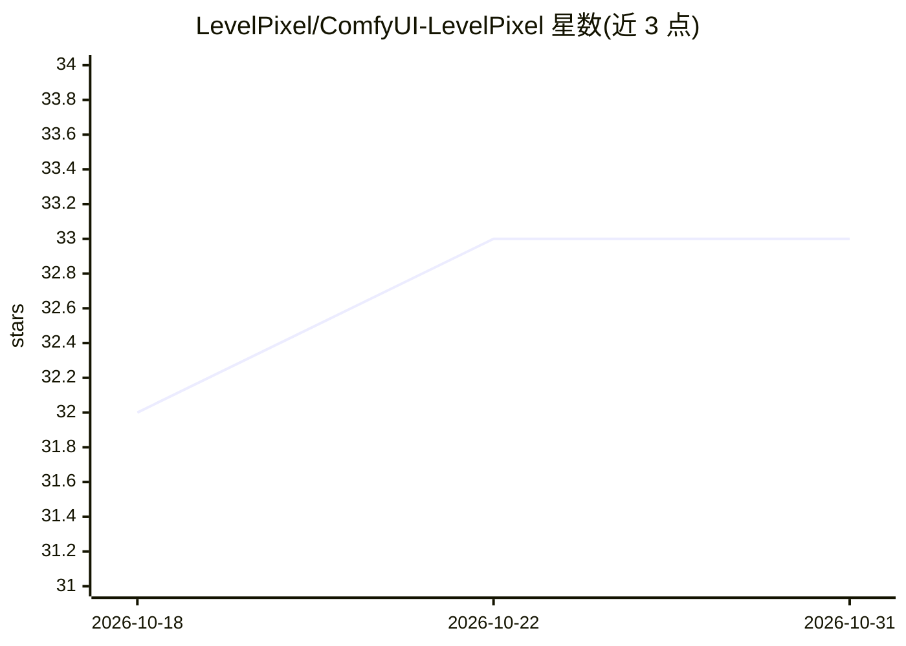

# LevelPixel/ComfyUI-LevelPixel

⭐ 33 · Python · GPL-3.0 · 推送 2026-02-24 · [GitHub](https://github.com/LevelPixel/ComfyUI-LevelPixel) · [官网](https://www.patreon.com/LevelPixel) · 组织维护

**ComfyUI 节点包：提供图像处理与工作流逻辑的原子节点**

面向 ComfyUI 用户的自定义节点集合，收录面向自动化工作流的基础节点：Inpaint Crop and Stitch（按蒙裁剪图像片段并在修改后缝回，支持批量）、Resize Image and Masks、Tag Category Filter、Model Unloader（含清理 RAM/VRAM）、Image Loader From Path、Image Overlay、类型转换节点、Pipe/JSON 节点等。部分节点核心功能取自其他节点包并注明出处。LLM/VLM/Autotagger 等模型包装节点已拆分至 Level Pixel Advanced 包。提供 ComfyUI Manager 安装与 git clone 安装两种方式。

## 筛选速览

| 维度 | 判定 | 备注 |
|---|---|---|
| AI 角色 | `ai-ecosystem` | LLM/agent 周边工具 |
| 许可风险 | `viral` | GPL-3.0 |
| 部署形态 | `None` |  |
| 模型依赖 | — | README 未给出锁定关系 |
| 硬件要求 | — | 无带数字的原话,不猜 |
| 安装摩擦 | `low` | 无编译、无系统依赖或容器化 |
| 成熟度 | — | 结构信号不足 |

## 能力要点

- Inpaint Crop and Stitch 按蒙裁剪/缝回图像片段，支持批量处理
- Model Unloader 节点支持 Hard/Soft/指定模型卸载及清理 RAM/VRAM
- 多种类型转换节点（String/Int/Float/Bool 等互转）与 Pipe/JSON 节点
- 许可由 Apache 2.0 变更为 GNU GPLv3

## 适用场景

- 在 ComfyUI 中构建自动化 Inpaint 流程：裁剪片段、修改后缝回
- 批量加载与归一化图像及蒙版尺寸
- 工作流中清理显存、按条件输出文本或图像

## 场景标签

`图像视频处理` · 领域:感知与多模态

## 证据(README 行号)

> L5: The purpose of this package is to collect the most necessary and atomic nodes for working with any tasks, adapted fo
> L10: Inpaint Crop and Stitch, Pipeline, Tag Category Filter nodes, Model Unloader nodes, File Counter, Object Counter, I

## 星数曲线

2026-10-18 32 → 2026-10-31 33（+1）

---
*卡片 v1 · prompt 1.4 · 生成 2026-10-25 · 置信度 high · 依据 README sha `ffbc24aeb0bc` · [字段定义](../../DATASET.md)*
