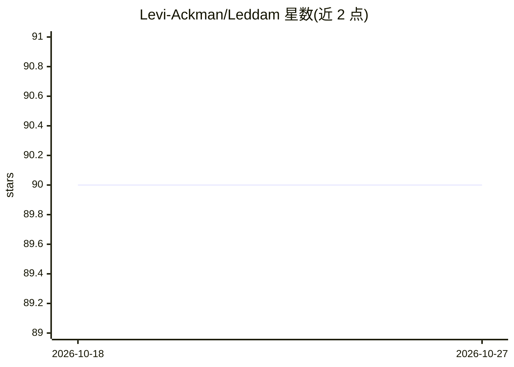

# Levi-Ackman/Leddam

⭐ 90 · Python · MIT · 推送 2026-09-29 · [GitHub](https://github.com/Levi-Ackman/Leddam) · [官网](https://openreview.net/forum?id=87CYNyCGOo) · 个人维护

**ICML 2024 多变量时间序列预测模型 Leddam 官方实现**

论文 "Revitalizing Multivariate Time Series Forecasting" 的官方代码实现，提出可学习分解并建模序列间依赖与序列内变化。提供 pip 依赖安装、预处理好的数据集下载与实验脚本，可在八个基准数据集上复现论文结果（如 input-96-predict-96 配置），训练历史与结果输出到 logs 目录。面向时间序列预测研究者与复现论文实验的用户。

## 筛选速览

| 维度 | 判定 | 备注 |
|---|---|---|
| AI 角色 | `ai-native` | 本体是模型或模型工具 |
| 许可风险 | `permissive` | MIT |
| 部署形态 | `library` | 以包/库形式分发 |
| 模型依赖 | — | README 未给出锁定关系 |
| 硬件要求 | — | 无带数字的原话,不猜 |
| 安装摩擦 | `low` | 无编译、无系统依赖或容器化 |
| 成熟度 | — | 结构信号不足 |

## 能力要点

- 可学习分解建模序列间依赖与序列内变化
- 提供八个基准数据集的实验脚本，可复现论文结果
- 数据集已预处理，run_script.py 一键运行

## 适用场景

- 复现 ICML 2024 论文的基准实验结果
- 在 Traffic 等数据集上运行多变量时间序列预测
- 作为 Leddam 模型实现用于时间序列预测研究

## 场景标签

 · 领域:机器学习/时间序列预测

## 证据(README 行号)

> L1: (ICML 2024) Revitalizing Multivariate Time Series Forecasting: Learnable Decomposition with Inter-Series Dependencie
> L19: 3. Train the model. We provide the experiment scripts of all benchmarks under the folder `./scripts`. You can repli

## 星数曲线

2026-10-18 90 → 2026-10-27 90（+0）

---
*卡片 v1 · prompt 1.4 · 生成 2026-10-23 · 置信度 mid · 依据 README sha `d91267d81864` · [字段定义](../../DATASET.md)*
