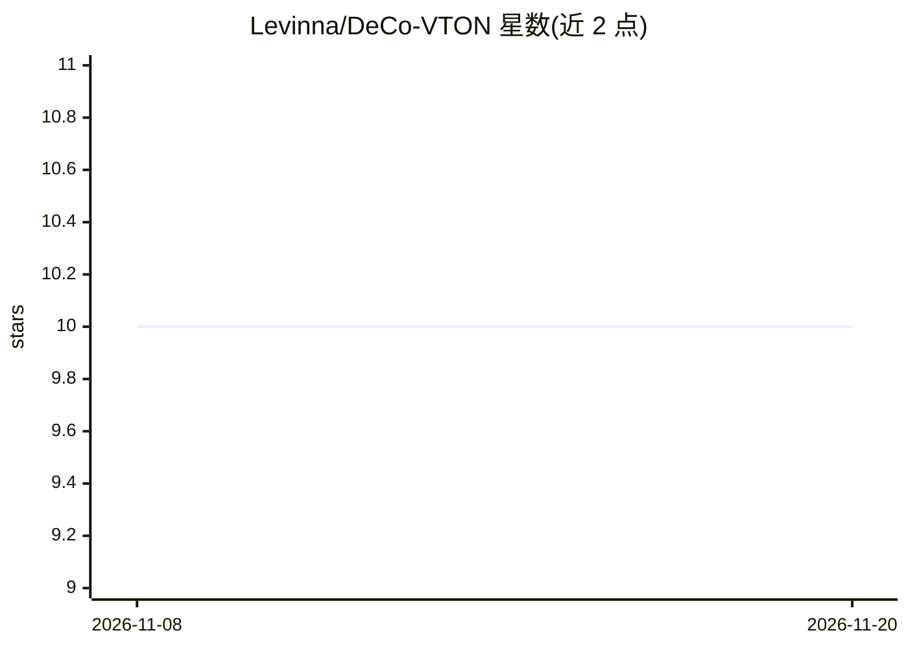

# Levinna/DeCo-VTON

⭐ 10 · Python · NOASSERTION · 推送 2026-09-24 · [GitHub](https://github.com/Levinna/DeCo-VTON) · [官网](https://arxiv.org/abs/2511.18775) · 组织维护

**面向研究者的扩散模型虚拟试穿实现：服装条件与去噪目标解耦**

ECCV 2026 论文的官方 PyTorch 实现，最初以 Re-CatVTON 发布。单一 UNet 虚拟试穿模型，将服装条件控制从去噪目标中分离，基于 Stable Diffusion 1.5 inpainting 架构构建，无需独立服装 UNet。提供推理代码与 VITON-HD / DressCode 上 512 与 1024 分辨率的预训练权重，支持从 Hugging Face Hub 加载或本地加载，附带 FID/KID/LPIPS 等评估脚本。训练代码未包含在本次发布中。

## 筛选速览

| 维度 | 判定 | 备注 |
|---|---|---|
| AI 角色 | `ai-native` | 本体是模型或模型工具 |
| 许可风险 | `none` | NOASSERTION |
| 部署形态 | `library` | 以包/库形式分发 |
| 模型依赖 | — | README 未给出锁定关系 |
| 硬件要求 | — | 无带数字的原话,不猜 |
| 安装摩擦 | `medium` | 含编译或系统依赖之一 |
| 成熟度 | — | 结构信号不足 |

## 能力要点

- 单 UNet 架构：服装条件与去噪目标解耦，基于 SD 1.5 inpainting
- 提供 VITON-HD / DressCode 的 512 与 1024 四组预训练 checkpoint
- 支持 ddim/ddpm/unipc/dpmpp 采样器及 VAE tiling 降低显存占用
- 评估脚本报告 PyTorch-FID、Clean-FID、Clean-KID 及 PSNR/SSIM/LPIPS

## 适用场景

- 在 VITON-HD 或 DressCode 数据集上复现论文虚拟试穿推理结果
- 以 Python pipeline 形式将试穿生成集成到自己的流程中
- 对不同虚拟试穿方法做统一的量化评估对比

## 场景标签

`图像生成` · 领域:内容生成

## 证据(README 行号)

> L17: DeCo-VTON is a single-UNet virtual try-on model that separates garment conditioning from the denoising target. It b
> L3: Official PyTorch implementation of **Rethinking Garment Conditioning in Diffusion-based Virtual Try-On: Decouple, Do

## 星数曲线

2026-11-08 10 → 2026-11-20 10（+0）

---
*卡片 v1 · prompt 1.4 · 生成 2026-11-20 · 置信度 high · 依据 README sha `7ba9b600ba17` · [字段定义](../../DATASET.md)*
