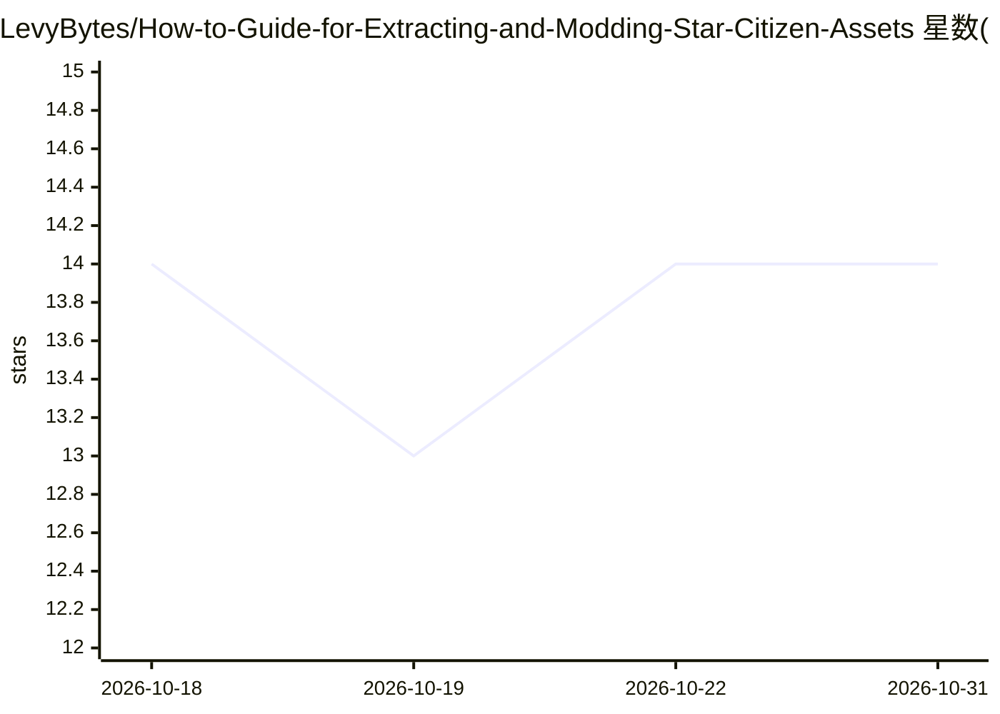

# LevyBytes/How-to-Guide-for-Extracting-and-Modding-Star-Citizen-Assets

⭐ 14 · Batchfile · Apache-2.0 · 推送 2026-06-02 · [GitHub](https://github.com/LevyBytes/How-to-Guide-for-Extracting-and-Modding-Star-Citizen-Assets) · [官网](https://discord.gg/6dvWCfthJ2) · 个人维护

**面向高级用户的 Star Citizen 资产提取与模组制作全流程教程**

由 DirectorGunner 维护的社区教程仓库（living document），为 Windows 11 高级用户、模组制作者与艺术家提供从零开始的 Star Citizen 资产提取工作流：通过一键安装脚本或手动步骤安装 Git、Rust、Visual Studio Build Tools、Python、Node.js 等工具，克隆 StarBreaker、Blender-Tools、unp4k、Cryengine-Converter、SCTextureConverter 等社区项目，组织版本化的 Data.p4k 文件，构建 StarBreaker 及其 MCP 服务，并在 Blender 中打开导出的资产（以 Aurora MR 为示例）。安装器支持重跑与状态续接。限制：要求关闭 Windows 11 Smart App Control，且工具链可能随 CIG 更新游戏数据格式而失效。

## 筛选速览

| 维度 | 判定 | 备注 |
|---|---|---|
| AI 角色 | `ai-knowledge` | 知识聚合/清单类 |
| 许可风险 | `permissive` | Apache-2.0 |
| 部署形态 | `desktop` | 安装包/桌面程序 |
| 模型依赖 | — | README 未给出锁定关系 |
| 硬件要求 | — | 无带数字的原话,不猜 |
| 安装摩擦 | `high` | 编译与系统依赖俱全 |
| 成熟度 | — | 结构信号不足 |

## 能力要点

- 一键安装脚本 Launch-SC-Zero-to-Hero-Setup.cmd，支持重跑与已完成步骤复用
- 整合 StarBreaker、Blender、unp4k、Cryengine-Converter 等多个社区工具为一条流水线
- 覆盖 Data.p4k 组织、舰船实体与配装解析、Blender 导入的端到端示例
- 包含 AI 辅助多仓库 VS Code 工作区与 StarBreaker MCP 本地构建

## 适用场景

- 我想在 Windows 上从零搭好 Star Citizen 资产提取与 Blender 模组环境
- 我想用 StarBreaker 导出并打开特定舰船（如 Aurora MR）的模型
- 我想了解 AI 辅助的社区工具开发工作流

## 场景标签

`教程课程` · 领域:学习与行业

## 证据(README 行号)

> L3: A modern Windows power-user workflow for StarBreaker, Blender, `Data.p4k` exploration, and AI-assisted community too
> L13: The goal of this repo is to maintain an all-in-one workflow that brings together community projects like StarBreake
> L130: This workflow builds on work from several community projects:

## 星数曲线

2026-10-18 14 → 2026-10-31 14（+0）

---
*卡片 v1 · prompt 1.4 · 生成 2026-10-31 · 置信度 mid · 依据 README sha `c2b2ef481f8d` · [字段定义](../../DATASET.md)*
