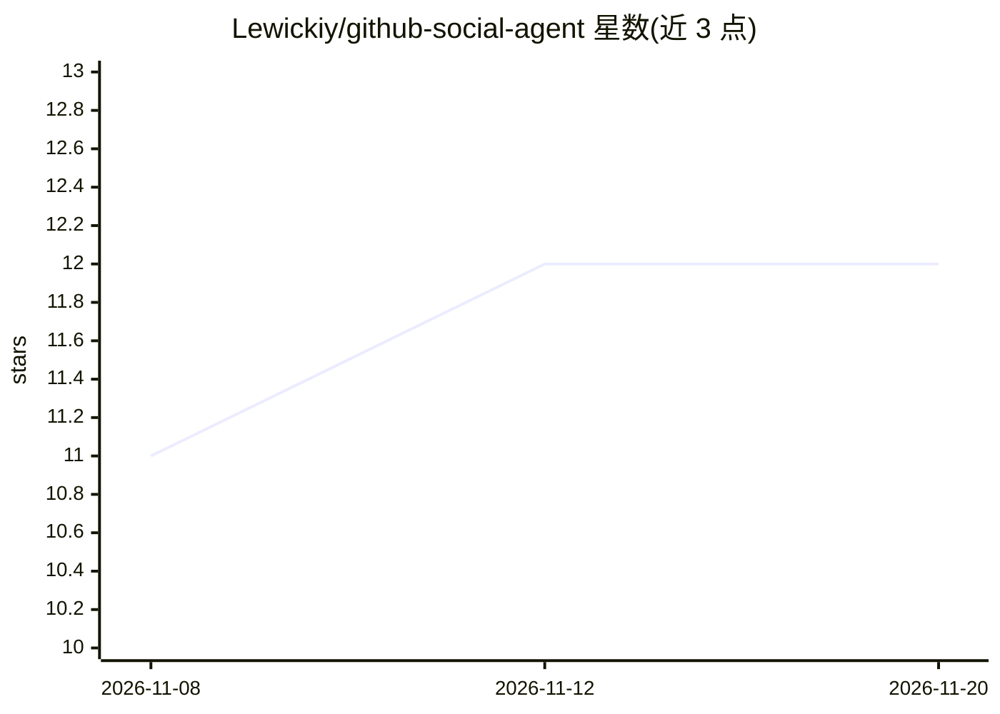

# Lewickiy/github-social-agent

⭐ 12 · Python · NOASSERTION · 推送 2026-08-11 · [GitHub](https://github.com/Lewickiy/github-social-agent) · [官网](https://lewickiy.github.io/github-social-agent/) · 个人维护

**自动发现并关注匹配你技术栈的 GitHub 开发者的社交网络代理**

由两部分组成的 GitHub 社交网络自动化系统：Python 分析 bot 与 FastAPI+React 仪表盘。它遍历关注者图谱并挖掘自己仓库的 stargazers/贡献者，按语言、话题、仓库新鲜度计算 0-100 相似度评分；内置 PyTorch 模型预测回关概率（默认 shadow 模式，仅作可选把关）；关注、取关、互惠回馈等操作由专职 worker 以人类化节奏与共享每日预算执行。通过 --silent 守护模式持续运行，Docker Compose 部署，仪表盘提供 9 个 worker 的控制与增长分析。

## 筛选速览

| 维度 | 判定 | 备注 |
|---|---|---|
| AI 角色 | `ai-enhanced` | 去掉 AI 部分产品仍成立 |
| 许可风险 | `none` | NOASSERTION |
| 部署形态 | `self-host` | docker 或自建部署 |
| 模型依赖 | — | README 未给出锁定关系 |
| 硬件要求 | — | 无带数字的原话,不猜 |
| 安装摩擦 | `low` | 无编译、无系统依赖或容器化 |
| 成熟度 | `idea` | |

## 能力要点

-  follower 图谱 + 仓库 stargazers/贡献者双维度发现机制
- PyTorch 回关概率预测模型（默认 shadow 模式，默认关闭决策把关）
- 9 个后台 worker：关注/取关/互惠/图谱漫游/快照等，仪表盘可逐个启停
- 限流韧性：Retry-After、指数退避、ETag 条件请求、每日 50 次共享预算

## 适用场景

- 让 GitHub 账号自动关注与我技术栈相近的开发者
- 自动回关 star/fork 我仓库的人并 star 他们的仓库
- 通过仪表盘查看关注网络增长与模型状态

## 场景标签

`工作流自动化` · 领域:效率与自动化

## 证据(README 行号)

> L53: |**Choosing "who to follow so they follow you back"**|A neural network predicts the followback probability as a sec
> L76: - **ML follow-back prediction (shadow mode)** — an experimental PyTorch model that learns from historical follow-ba
> L116: > The deterministic scoring algorithm is responsible for follow decisions.

## 星数曲线

2026-11-08 11 → 2026-11-20 12（+1）

---
*卡片 v1 · prompt 1.4 · 生成 2026-11-18 · 置信度 low · 依据 README sha `fa35f2155a0e` · [字段定义](../../DATASET.md)*
