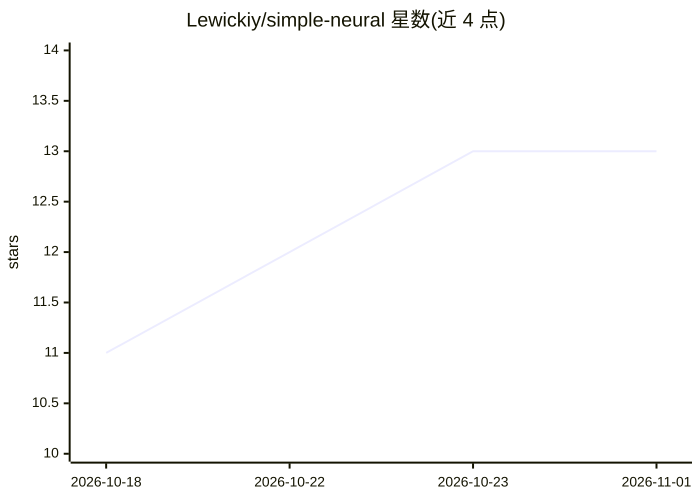

# Lewickiy/simple-neural

⭐ 13 · Java · 推送 2026-07-26 · [GitHub](https://github.com/Lewickiy/simple-neural) · 个人维护

**Java 教学用前馈神经网络实现，含反向传播与分类示例**

用 Java 从零实现的全连接前馈神经网络，面向机器学习入门者演示前向传播、反向传播、权重更新、sigmoid 激活函数与 Feature Scaling 归一化。支持任意层数/神经元数的网络架构配置，内置 Iris 与 Wine 两个数据集的分类器与评估输出。提供 JUnit 4 单元测试与 JaCoCo 覆盖率报告。需 Java 11+ 与 Maven 3.6+，通过源码克隆与 mvn 编译运行；权重保存、ReLU/Tanh 激活等列为开发中功能。

## 筛选速览

| 维度 | 判定 | 备注 |
|---|---|---|
| AI 角色 | `ai-native` | 本体是模型或模型工具 |
| 许可风险 | `none` | — |
| 部署形态 | `None` |  |
| 模型依赖 | — | README 未给出锁定关系 |
| 硬件要求 | — | 无带数字的原话,不猜 |
| 安装摩擦 | `medium` | 含编译或系统依赖之一 |
| 成熟度 | — | 结构信号不足 |

## 能力要点

- 任意架构的全连接网络，支持学习率与激活函数配置
- 实现前向传播、反向传播与权重更新的教学级代码
- 内置 Iris 与 Wine 数据集分类器及准确率评估
- Feature Scaling 数据归一化与 JUnit 4 测试

## 适用场景

- 学习神经网络前向/反向传播的代码级实现
- 在 Iris/Wine 数据集上运行分类示例
- 作为机器学习课程的教学参考代码

## 场景标签

 · 领域:机器学习教育

## 证据(README 行号)

> L9: - Обратного распространения (backpropagation)
> L14: Сеть предназначена для обучения и понимания фундаментальных принципов работы нейронных сетей.
> L194: Идеален для студентов и начинающих, изучающих основы машинного обучения и нейронных сетей.

## 星数曲线

2026-10-18 11 → 2026-11-01 13（+2）

---
*卡片 v1 · prompt 1.4 · 生成 2026-10-31 · 置信度 high · 依据 README sha `a9e998633294` · [字段定义](../../DATASET.md)*
