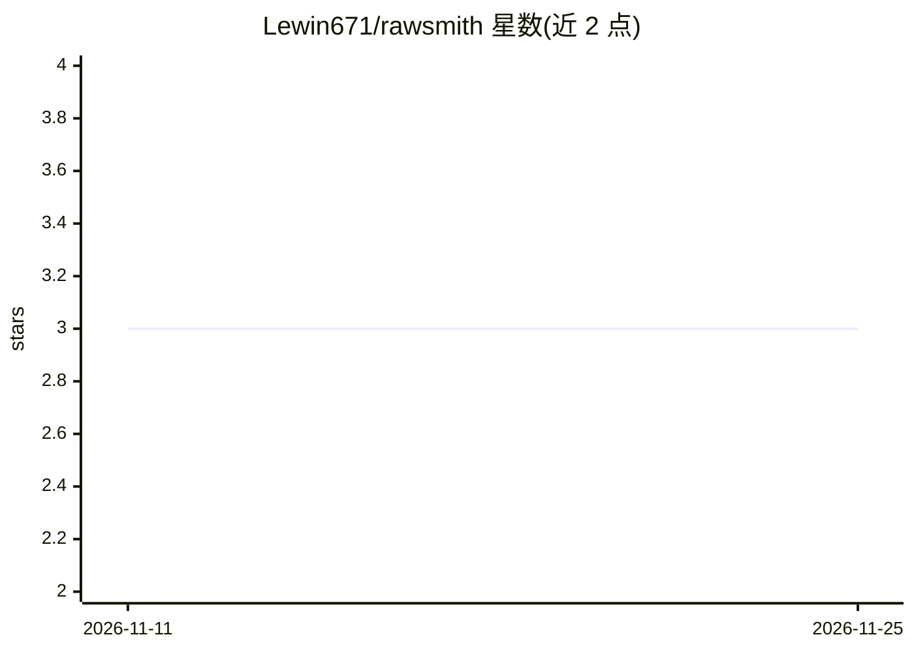

# Lewin671/rawsmith

⭐ 3 · Rust · Apache-2.0 · 推送 2026-10-29 · [GitHub](https://github.com/Lewin671/rawsmith) · 个人维护 · 中文 README

**供 AI 助手调用的本地 RAW 照片显影 CLI，编辑即 JSON 配方**

用 Rust 编写的命令行 RAW 显影工具，为 Claude Code/Codex 等助手配备编辑 skill：助手通过 inspect/auto/edit/render 等命令查看图像统计、修改 JSON 配方并渲染预览，迭代完成裁剪、曝光与色彩调整；每条编辑是一个仅记录差异项的配方文件，同一配方与二进制可得到逐位一致的输出。RAW 原文件不被修改，本地离线运行；目前仅支持 Sony A7 IV Bayer ARW，输出 sRGB JPEG 或 16-bit PNG 且不含相机元数据。

## 筛选速览

| 维度 | 判定 | 备注 |
|---|---|---|
| AI 角色 | `ai-enhanced` | 去掉 AI 部分产品仍成立 |
| 许可风险 | `permissive` | Apache-2.0 |
| 部署形态 | `None` |  |
| 模型依赖 | — | README 未给出锁定关系 |
| 硬件要求 | — | 无带数字的原话,不猜 |
| 安装摩擦 | `low` | 无编译、无系统依赖或容器化 |
| 成熟度 | — | 结构信号不足 |

## 能力要点

- 每个编辑是 JSON 配方，同配方同二进制输出逐位可复现
- 命令返回 JSON 与直方/裁切/色彩统计，供助手按数值校验结果
- 非破坏式编辑：RAW 永不修改，配方保存于 RAW 旁的 .rawsmith.json
- 本地离线运行，输出不含 EXIF/GPS/序列号

## 适用场景

- 让 Claude Code/Codex 助手对 RAW 照片做自动显影与调色
- 用可复现的 JSON 配方管理批量的非破坏式 RAW 编辑
- 本地处理照片以保持原图不变并避免元数据泄露

## 场景标签

`图像视频处理` · 领域:感知与多模态

## 证据(README 行号)

> L8: rawsmith is a command-line RAW developer built for AI assistants, plus a
> L15: - **Local.** Photos are developed on your machine; the RAW is never modified.
> L29: Install the CLI and the skill for Claude Code and Codex (macOS or Linux,

## 星数曲线

2026-11-11 3 → 2026-11-25 3（+0）

---
*卡片 v1 · prompt 1.4 · 生成 2026-11-22 · 置信度 high · 依据 README sha `0857f7a566f5` · [字段定义](../../DATASET.md)*
