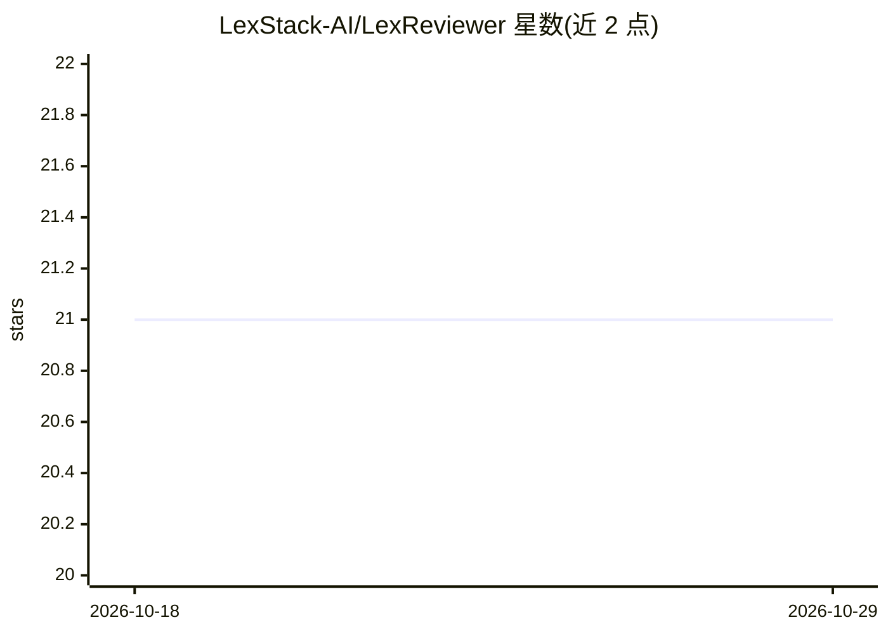

# LexStack-AI/LexReviewer

⭐ 21 · Python · 推送 2026-03-16 · [GitHub](https://github.com/LexStack-AI/LexReviewer) · 组织维护

**面向法律 PDF 的引用感知 RAG 问答后端服务**

单一后端服务，整合法律 PDF 摄取、检索与流式问答：通过 Unstructured.io 解析 PDF 并分块（保留边界框元数据），在 Qdrant 向量检索与 BM25 关键词检索间组合查询，由 LangGraph agent 按问题选择工具，OpenAI 模型生成回答并以 NDJSON 流式输出，附带引用位置与边界框可用于原文高亮。聊天历史持久化于 MongoDB，支持关联文档检索，提供 Streamlit UI 与 HTTP API。运行需 OpenAI 与 Unstructured.io 的 API key，以及 MongoDB、Qdrant 实例。

## 筛选速览

| 维度 | 判定 | 备注 |
|---|---|---|
| AI 角色 | `ai-native` | 本体是模型或模型工具 |
| 许可风险 | `none` | — |
| 部署形态 | `None` |  |
| 模型依赖 | — | README 未给出锁定关系 |
| 硬件要求 | — | 无带数字的原话,不猜 |
| 安装摩擦 | `low` | 无编译、无系统依赖或容器化 |
| 成熟度 | — | 结构信号不足 |

## 能力要点

- 回答附带引用位置与边界框，可映射回原文高亮
- Qdrant 向量检索 + BM25 关键词检索的混合检索
- LangGraph agent 按问题选择文档内检索或关联文档工具
- MongoDB 持久化多轮对话历史并支持摘要压缩

## 适用场景

- 对合同等法律 PDF 做可溯源的问答
- 合规审查时定位回答在原文中的具体位置
- 跨修订稿、附表、MSA 等关联文件联合查询

## 场景标签

`RAG` `文档问答` · 领域:知识与检索

## 证据(README 行号)

> L7: Legal PDFs are a pain to search, and you can’t really “talk” to them, plus when you do get answers elsewhere, they o
> L9: As a single backend service, **LexReviewer** brings together PDF ingestion, vector + keyword retrieval, streaming RA

## 星数曲线

2026-10-18 21 → 2026-10-29 21（+0）

---
*卡片 v1 · prompt 1.4 · 生成 2026-10-28 · 置信度 high · 依据 README sha `a94a6b8b58b7` · [字段定义](../../DATASET.md)*
