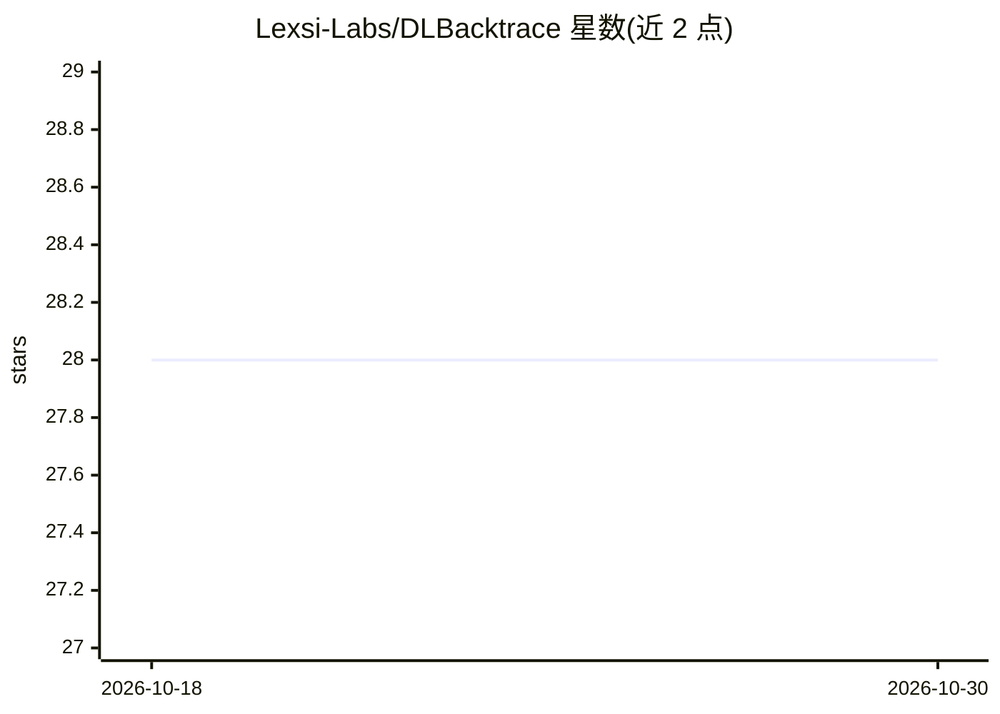

# Lexsi-Labs/DLBacktrace

⭐ 28 · Python · NOASSERTION · 推送 2026-05-13 · [GitHub](https://github.com/Lexsi-Labs/DLBacktrace) · [官网](https://dlbacktrace.lexsi.ai/) · 组织维护

**给深度学习研究者的模型无关可解释性框架：逐层相关性溯源**

Lexsi Labs 开发的模型无关深度学习可解释性框架：通过逐层相关性传播（relevance propagation）为 CNN、RNN、Transformer、LLM 及 MoE 等架构提供层级重要性分数，覆盖表格、视觉、文本任务及分类、检测、分割、文本生成。附带高层 Pipeline 接口、带 token 级相关性追踪的多策略文本采样器（DLB Auto Sampler）与 MoE 专家级分析；支持 CPU/GPU 与确定性执行环境，v2 号称在 LLaMA-3.2-3B 基准上大幅提速。以 pip 包提供，使用自定义 License。

## 筛选速览

| 维度 | 判定 | 备注 |
|---|---|---|
| AI 角色 | `ai-ecosystem` | LLM/agent 周边工具 |
| 许可风险 | `none` | NOASSERTION |
| 部署形态 | `library` | 以包/库形式分发 |
| 模型依赖 | — | README 未给出锁定关系 |
| 硬件要求 | — | 无带数字的原话,不猜 |
| 安装摩擦 | `medium` | 含编译或系统依赖之一 |
| 成熟度 | — | 结构信号不足 |

## 能力要点

- 逐层相关性传播，架构无关（CNN/RNN/Transformer/LLM/MoE）
- DLB Auto Sampler 多解码策略并带 token 级相关性追踪
- 内置 MoE 专家级相关性分析（JetMoE/OLMoE/Qwen3-MoE/GPT-Oss）
- 确定性执行环境，CPU/GPU 均可运行

## 适用场景

- 解释分类、检测、分割与文本生成模型的决策依据
- 分析 MoE 模型中各专家的贡献
- 为已训练 PyTorch 模型生成层级重要性可视化

## 场景标签

 · 领域:深度学习可解释性（XAI）

## 证据(README 行号)

> L10: DLBacktrace is a model-agnostic explainability framework developed by *Lexsi Labs*. It provides comprehensive layer
> L15: - **🔍 Deep Model Interpretability:** Gain comprehensive insights into your AI models using advanced relevance propa

## 星数曲线

2026-10-18 28 → 2026-10-30 28（+0）

---
*卡片 v1 · prompt 1.4 · 生成 2026-10-26 · 置信度 high · 依据 README sha `e5d62533eb3e` · [字段定义](../../DATASET.md)*
