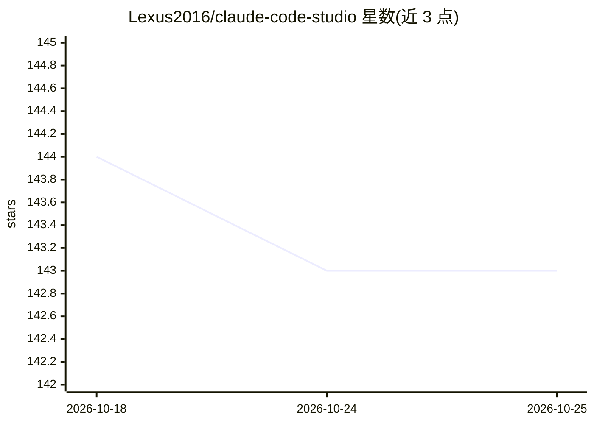

# Lexus2016/claude-code-studio

⭐ 143 · JavaScript · 推送 2026-10-23 · [GitHub](https://github.com/Lexus2016/claude-code-studio) · 个人维护

**Claude Code CLI 的浏览器工作台：聊天、看板、调度与多 agent 编排**

为 Claude Code CLI 提供的 Web 与桌面端界面：实时聊天驱动 Claude 读写文件、跑测试；含 Kanban 任务看板、任务调度、任务执行中自动生成子任务、多任务并行、多 agent 编排、MCP 服务器与技能管理，以及 Telegram/SSH/Web 远程访问。会话由 SQLite 持久化并支持自恢复重放。运行需 Node.js 18+ 并已安装登录 Claude Code CLI（Pro 或 Max 订阅）；提供 npx、npm 全局安装、源码、Docker 与三平台桌面安装包等途径。

## 筛选速览

| 维度 | 判定 | 备注 |
|---|---|---|
| AI 角色 | `ai-ecosystem` | LLM/agent 周边工具 |
| 许可风险 | `none` | — |
| 部署形态 | `desktop` | 安装包/桌面程序 |
| 模型依赖 | locked-api |  |
| 硬件要求 | — | 无带数字的原话,不猜 |
| 安装摩擦 | `low` | 无编译、无系统依赖或容器化 |
| 成熟度 | — | 结构信号不足 |

## 能力要点

- Kanban 看板 + 调度器，任务执行中可自动派生子任务
- SQLite 持久化会话与自恢复重放，支持多任务并行
- MCP 服务器、技能、多 agent 编排与 Telegram/SSH 远程访问
- 桌面版支持 macOS(Apple Silicon)/Windows/Linux，内置自动更新

## 适用场景

- 给 Claude Code CLI 换一个带看板和调度的图形界面
- 排队任务后离开，回来查看自动完成的结果
- 通过 Telegram 或手机远程查看任务进展

## 场景标签

`编码 Agent` `多智能体` · 领域:Agent 开发

## 证据(README 行号)

> L5: **The browser interface for Claude Code CLI.** Chat with AI, run tasks on autopilot, and manage your projects — all 
> L75: **Prerequisites:** Node.js 18+ + Claude Code CLI installed and logged in (Claude Pro or Max subscription)
> L149: Not a chatbot. "Refactor this function and add tests" → Claude opens files, edits them, runs tests, fixes errors, 

## 星数曲线

2026-10-18 144 → 2026-10-25 143（-1）

---
*卡片 v1 · prompt 1.4 · 生成 2026-10-22 · 置信度 high · 依据 README sha `7242de0ba61f` · [字段定义](../../DATASET.md)*
