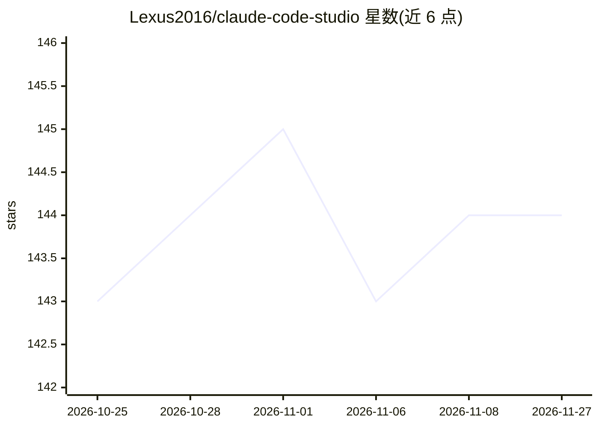

# Lexus2016/claude-code-studio

⭐ 144 · JavaScript · 推送 2026-11-26 · [GitHub](https://github.com/Lexus2016/claude-code-studio) · [官网](https://lexus2016.github.io/claude-code-studio/) · 个人维护

**为 Claude Code CLI 提供网页/桌面工作台的 WebUI**

自托管的工作区，把 Claude Code CLI 包装成浏览器或原生桌面应用使用：SQLite 存储的会话与项目历史、看板任务队列与定时任务、多 agent 编排、MCP 服务器与 skills 管理、SSH/Telegram 远程访问，并提供文件/截图附件、任务中插入澄清指令、思考过程持久化与翻译等能力。前置要求为 Node.js 18+ 与已登录的 Claude Code CLI（Claude Pro/Max 订阅），默认仅监听 localhost，桌面版单用户绑定 127.0.0.1。

## 筛选速览

| 维度 | 判定 | 备注 |
|---|---|---|
| AI 角色 | `ai-ecosystem` | LLM/agent 周边工具 |
| 许可风险 | `none` | — |
| 部署形态 | `desktop` | 安装包/桌面程序 |
| 模型依赖 | — | README 未给出锁定关系 |
| 硬件要求 | — | 无带数字的原话,不猜 |
| 安装摩擦 | `low` | 无编译、无系统依赖或容器化 |
| 成熟度 | — | 结构信号不足 |

## 能力要点

- 聊天、看板任务、定时任务与多 agent 编排集成在统一界面
- 支持 MCP 服务器、skills 管理与 Claude CLI 会话导入
- SSH 与 Telegram 远程访问，任务进行中可插入澄清或排队指令
- 提供 macOS/Windows/Linux 桌面安装包并内置自更新

## 适用场景

- 在浏览器或桌面窗口中使用 Claude Code 而不是终端
- 用看板和定时任务组织多个编码任务的队列与结果审查
- 通过 Telegram 或 SSH 远程操控本地 Claude Code 会话

## 场景标签

`编码 Agent` · 领域:编码与开发

## 证据(README 行号)

> L5: **A self-hosted web and desktop workspace for Claude Code CLI: chat, Kanban tasks, and project management.**
> L23: Use Claude Code from a browser or desktop window, with project work organized in one interface.
> L66: **Prerequisites:** Node.js 18+ + Claude Code CLI installed and logged in (Claude Pro or Max subscription)

## 星数曲线

2026-10-25 143 → 2026-11-27 144（+1）

---
*卡片 v1 · prompt 1.4 · 生成 2026-11-27 · 置信度 high · 依据 README sha `97842882d85b` · [字段定义](../../DATASET.md)*
