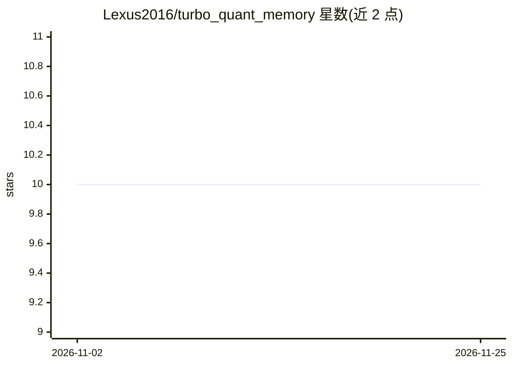

# Lexus2016/turbo_quant_memory

⭐ 10 · Python · MIT · 推送 2026-11-10 · [GitHub](https://github.com/Lexus2016/turbo_quant_memory) · 个人维护

**给 AI 编码 agent 的本地优先 MCP 记忆服务器**

一个 MCP 服务器，为编码 agent 提供持久、可搜索的本地记忆存储：agent 工作中写入决策、经验、模式与会话交接笔记，并提供 Markdown 的紧凑索引；检索返回约 220 字符的结果卡片，按需再加载全文。提供 29 个 MCP 工具，支持项目/全局作用域、分层记忆、混合检索（BM25+稠密向量，RRF 融合）、知识图谱与 AES-256-GCM 加密的密钥库。数据完全留在本机，无 HTTP 客户端与遥测；首次运行从 Hugging Face 下载约 0.22 GB 嵌入模型，之后完全离线。需 Python 3.11+，通过 uv tool 安装，注册到 Claude Code、Codex、Gemini CLI、Cursor 等客户端。

## 筛选速览

| 维度 | 判定 | 备注 |
|---|---|---|
| AI 角色 | `ai-ecosystem` | LLM/agent 周边工具 |
| 许可风险 | `permissive` | MIT |
| 部署形态 | `library` | 以包/库形式分发 |
| 模型依赖 | — | README 未给出锁定关系 |
| 硬件要求 | — | 无带数字的原话,不猜 |
| 安装摩擦 | `low` | 无编译、无系统依赖或容器化 |
| 成熟度 | — | 结构信号不足 |

## 能力要点

- 29 个 MCP 工具：类型化笔记、分层记忆、知识图谱与文件历史恢复
- 混合检索：稠密向量 + BM25 经 RRF 融合，返回紧凑卡片按需水合
- 同一 git 工作树的多 agent 互相可见，文本文件变更被记录可恢复
- 内置 server_info() 统计累计节省的 token 数

## 适用场景

- 让编码 agent 在会话压缩后仍能检索之前的决策与结论
- 多个 agent 在同一项目协作时共享工作状态
- 在本地离线环境下为 agent 提供带密钥库的项目记忆

## 场景标签

`Agent 记忆` · 领域:Agent 开发

## 证据(README 行号)

> L30: **Turbo Quant Memory** is an MCP server that gives the agent a persistent, searchable store it writes to while it w
> L148: ## The 29 MCP tools

## 星数曲线

2026-11-02 10 → 2026-11-25 10（+0）

---
*卡片 v1 · prompt 1.4 · 生成 2026-11-20 · 置信度 high · 依据 README sha `bd39aebc6f81` · [字段定义](../../DATASET.md)*
