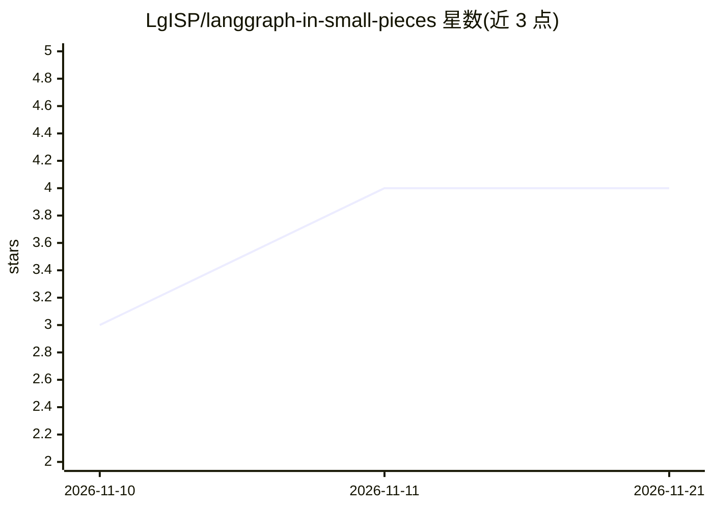

# LgISP/langgraph-in-small-pieces

⭐ 4 · Python · MIT · 推送 2026-11-02 · [GitHub](https://github.com/LgISP/langgraph-in-small-pieces) · [官网](LgISP.ai) · 个人维护 · 中文 README

**《LangGraph in Small Pieces》一书的配套可运行示例代码库**

为同名书籍提供配套代码：每章一个可运行的 Python 文件，外加每章末 Challenge 的自测式解答。全书围绕 LangGraph 构建 AI Agent，从基础模块到生产实践，共 32 章示例。所有代码默认在本机运行，Part I 仅需 LangGraph；Part II–III 通过 LM Studio 调用本地模型并使用本地 Chroma 向量库，绝大多数示例完全离线。版本以 requirements.txt 锁定为一组（Python 3.11 / LangGraph 1.2.16），COMPATIBILITY.md 记录后续版本的行为差异。

## 筛选速览

| 维度 | 判定 | 备注 |
|---|---|---|
| AI 角色 | `ai-knowledge` | 知识聚合/清单类 |
| 许可风险 | `permissive` | MIT |
| 部署形态 | `library` | 以包/库形式分发 |
| 模型依赖 | — | README 未给出锁定关系 |
| 硬件要求 | — | 无带数字的原话,不猜 |
| 安装摩擦 | `low` | 无编译、无系统依赖或容器化 |
| 成熟度 | — | 结构信号不足 |

## 能力要点

- 每章一个可运行示例文件，文件名对应章节编号
- Challenge 解答自包含测试，运行即验证
- 默认全离线：LM Studio 本地模型 + 本地 Chroma 向量库
- 提供工具脚本在本地模型与托管模型间切换代码中的模型配置

## 适用场景

- 跟随书籍逐章学习 LangGraph 构建 Agent
- 在无云账单、无 API key 的本地环境运行 Agent 示例
- 排查书籍版本与新版 LangGraph 的行为差异

## 场景标签

`教程课程` · 领域:学习与行业

## 证据(README 行号)

> L7: Companion code for the book **_LangGraph in Small Pieces: Building AI Agents from
> L8: Blocks to Production_**. One runnable file per chapter, plus worked solutions for
> L13: Everything runs on your own machine — no cloud model bill, and no API key except
> L14: for one optional section. Part I needs nothing but LangGraph; Parts II–III add a
> L57: Chapters 10 and up call a real LLM. The book runs it locally through LM Studio's

## 星数曲线

2026-11-10 3 → 2026-11-21 4（+1）

---
*卡片 v1 · prompt 1.4 · 生成 2026-11-21 · 置信度 high · 依据 README sha `f7e0cac03145` · [字段定义](../../DATASET.md)*
