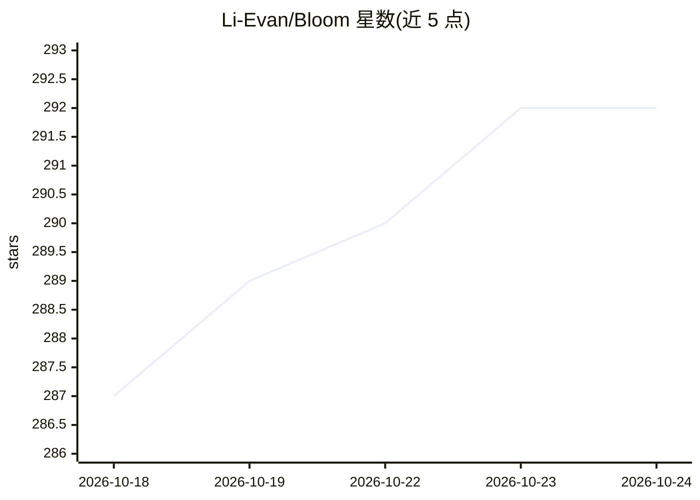

# Li-Evan/Bloom

⭐ 292 · JavaScript · MIT · 推送 2026-10-20 · [GitHub](https://github.com/Li-Evan/Bloom) · [官网](https://bloomtutor.app) · 个人维护 · 中文 README

**自适应 1 对 1 AI 家教：生成大纲与课程并按反馈调整**

基于 Bloom 2-Sigma 研究的 AI 辅导应用：按主题或上传的 PDF/TXT/MD 源生成课程大纲，逐课交付，读取用户批注与反馈后生成针对薄弱点的下一课，并提供划线即时问答、复习评估与学习历史统计。提供两种使用方式：CLI 模式（Claude Code 技能，含 bloom-tutor 与 6 个 learn-* 技能）和 Web 模式（React + FastAPI，支持 Docker），Web 模式接入任意 OpenAI 兼容 LLM API。面向个人学习者，中文优先。

## 筛选速览

| 维度 | 判定 | 备注 |
|---|---|---|
| AI 角色 | `ai-native` | 本体是模型或模型工具 |
| 许可风险 | `permissive` | MIT |
| 部署形态 | `self-host` | docker 或自建部署 |
| 模型依赖 | — | README 未给出锁定关系 |
| 硬件要求 | — | 无带数字的原话,不猜 |
| 安装摩擦 | `low` | 无编译、无系统依赖或容器化 |
| 成熟度 | — | 结构信号不足 |

## 能力要点

- 大纲→课程→批注→反馈→下一课的自适应学习流程
- 三种课程模式：主题生成 / 源文件阅读 / 项目文件浏览
- 7 个可移植的 Claude Code 技能（bloom-tutor 与 learn-* 系列）
- 划线即时问答与流式生成、学习日历与统计

## 适用场景

- 让 AI 按自己的理解程度生成并调整学习课程
- 上传教材或论文 PDF，边读边划线提问
- 把学习过程作为技能装入 Claude Code 随处使用

## 场景标签

`文档问答` · 领域:知识与检索

## 证据(README 行号)

> L21: **Bloom solves this with AI.** It generates a structured syllabus, delivers lessons one at a time, reads your annot
> L30: Both follow the same flow: **syllabus → lesson → annotate → feedback → next lesson → evaluation → summary**.
> L145: |AI|Any OpenAI-compatible LLM API|

## 星数曲线

2026-10-18 287 → 2026-10-24 292（+5）

---
*卡片 v1 · prompt 1.4 · 生成 2026-10-22 · 置信度 high · 依据 README sha `134ff3ee7963` · [字段定义](../../DATASET.md)*
