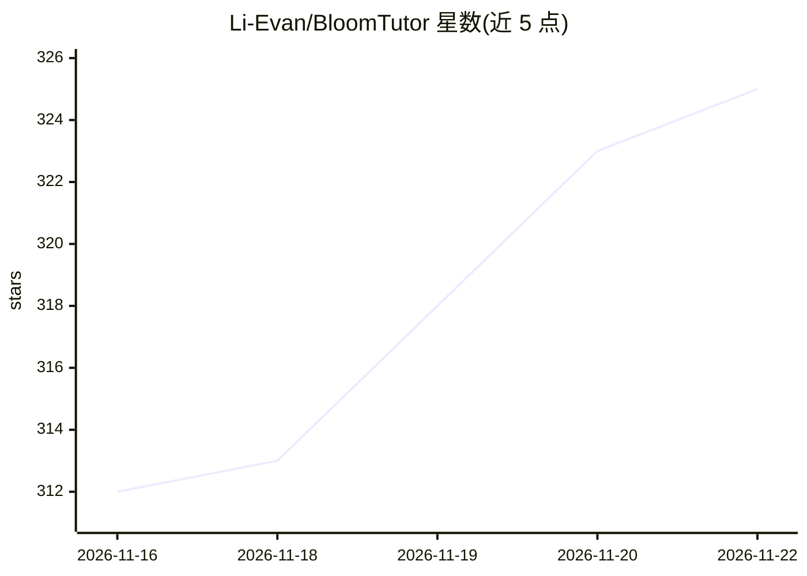

# Li-Evan/BloomTutor

⭐ 325 · Python · MIT · 推送 2026-11-21 · [GitHub](https://github.com/Li-Evan/BloomTutor) · [官网](https://bloomtutor.app/) · 个人维护 · 中文 README

**自托管 AI 家教：按个人理解水平生成与调整课程**

基于 Bloom 2-Sigma 研究的自托管个人 AI 辅导应用，提供 CLI（Claude Code 技能/DeepSeek Harness 插件）与 Web（Next.js + FastAPI，单用户无账户）两种使用方式。流程为：大纲→课程→标注→反馈→下节课→评估→总结。支持上传 PDF/Word/EPUB 等材料构建知识包并引用出处，提供高亮问答、知识地图、阅读时间轴等功能。模型接入任意 OpenAI 兼容 API（需自备 key），数据存于本地 SQLite/Postgres。CLI 依赖 Claude Code，Web 需 Python 3.11+ 与 Node.js 20+。

## 筛选速览

| 维度 | 判定 | 备注 |
|---|---|---|
| AI 角色 | `ai-native` | 本体是模型或模型工具 |
| 许可风险 | `permissive` | MIT |
| 部署形态 | `self-host` | docker 或自建部署 |
| 模型依赖 | local-ok | 支持本地模型 |
| 硬件要求 | — | 无带数字的原话,不猜 |
| 安装摩擦 | `low` | 无编译、无系统依赖或容器化 |
| 成熟度 | — | 结构信号不足 |

## 能力要点

- 大纲→课程→标注→反馈→下节课的适应性学习流程
- 上传 PDF/Word/EPUB/网页等材料，课程内容基于材料并附来源引用
- 7 个可移植 Claude Code 技能，兼容 DeepSeek Harness 插件
- 任意 OpenAI 兼容模型 API，数据存本地 SQLite/Postgres

## 适用场景

- 按自己的水平系统学习一个新主题
- 把自己的 PDF/文档资料变成有出处的定制课程
- 在阅读材料时高亮提问并获得后续建议

## 场景标签

`文档问答` · 领域:知识与检索

## 证据(README 行号)

> L21: **Bloom solves this with AI.** It generates a structured syllabus, delivers lessons one at a time, reads your annot
> L64: The web app is a self-hosted, single-user tutor: no accounts, no billing. You bring an API key for any OpenAI-compa
> L144: - **Adaptive lessons** — each lesson reviews your answers to the last one's questions, answers what you highlighte

## 星数曲线

2026-11-16 312 → 2026-11-22 325（+13）

---
*卡片 v1 · prompt 1.4 · 生成 2026-11-17 · 置信度 high · 依据 README sha `079079445024` · [字段定义](../../DATASET.md)*
