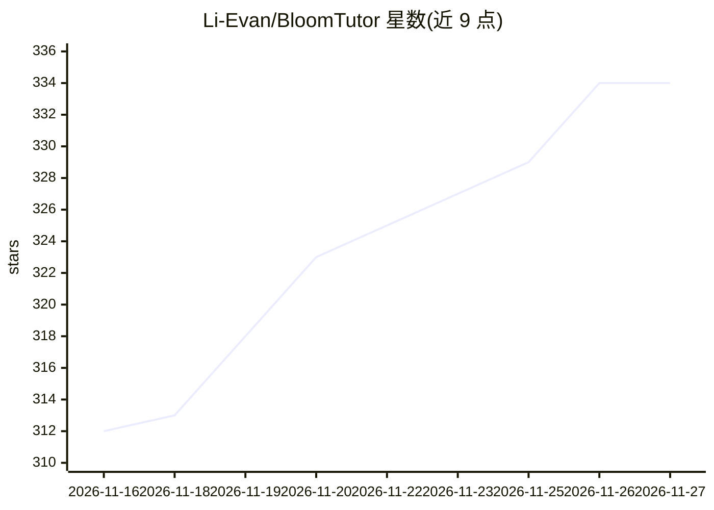

# Li-Evan/BloomTutor

⭐ 334 · Python · MIT · 推送 2026-11-21 · [GitHub](https://github.com/Li-Evan/BloomTutor) · [官网](https://bloomtutor.app/) · 个人维护 · 中文 README

**给学习者的开源 AI 家教：生成大纲并按反馈自适应授课**

基于 Bloom 2-Sigma 研究的开源 AI 家教，流程为大纲→课程→批注→反馈→下一课→评估→总结。提供两种使用方式：作为 Claude Code skill/插件在终端运行，或自托管的单用户 Web 应用（Next.js + FastAPI，无账号无计费）。Web 模式可上传 PDF/Office/EPUB 等资料构建知识包并生成带引用的课程，支持高亮问答、知识地图、间隔复习；模型通过任意 OpenAI 兼容 API 接入，需自备 API key。

## 筛选速览

| 维度 | 判定 | 备注 |
|---|---|---|
| AI 角色 | `ai-native` | 本体是模型或模型工具 |
| 许可风险 | `permissive` | MIT |
| 部署形态 | `self-host` | docker 或自建部署 |
| 模型依赖 | local-ok | 支持本地模型 |
| 硬件要求 | — | 无带数字的原话,不猜 |
| 安装摩擦 | `low` | 无编译、无系统依赖或容器化 |
| 成熟度 | — | 结构信号不足 |

## 能力要点

- CLI 与 Web 双模式：Claude Code 插件或自托管单用户 Web 应用
- 自适应教学：根据批注、答案与反馈调整下一课内容
- 上传 PDF/Office/EPUB/网页等资料构建知识包并带来源引用
- 7 个可移植 Claude Code skills（learn-deep、learn-feynman 等）

## 适用场景

- 给任意主题生成结构化大纲并逐课学习
- 上传自己的 PDF 和教材做有出处的辅导问答
- 在终端用 Claude Code skill 做深度学习、费曼式检验

## 场景标签

`文档问答` · 领域:知识与检索

## 证据(README 行号)

> L21: **Bloom solves this with AI.** It generates a structured syllabus, delivers lessons one at a time, reads your annot
> L30: Both follow the same flow: **syllabus → lesson → annotate → feedback → next lesson → evaluation → summary**.
> L66: The web app is a self-hosted, single-user tutor: no accounts, no billing. You bring an API key for any OpenAI-compa

## 星数曲线

2026-11-16 312 → 2026-11-27 334（+22）

---
*卡片 v1 · prompt 1.4 · 生成 2026-11-25 · 置信度 high · 依据 README sha `4437e2ae6bd8` · [字段定义](../../DATASET.md)*
